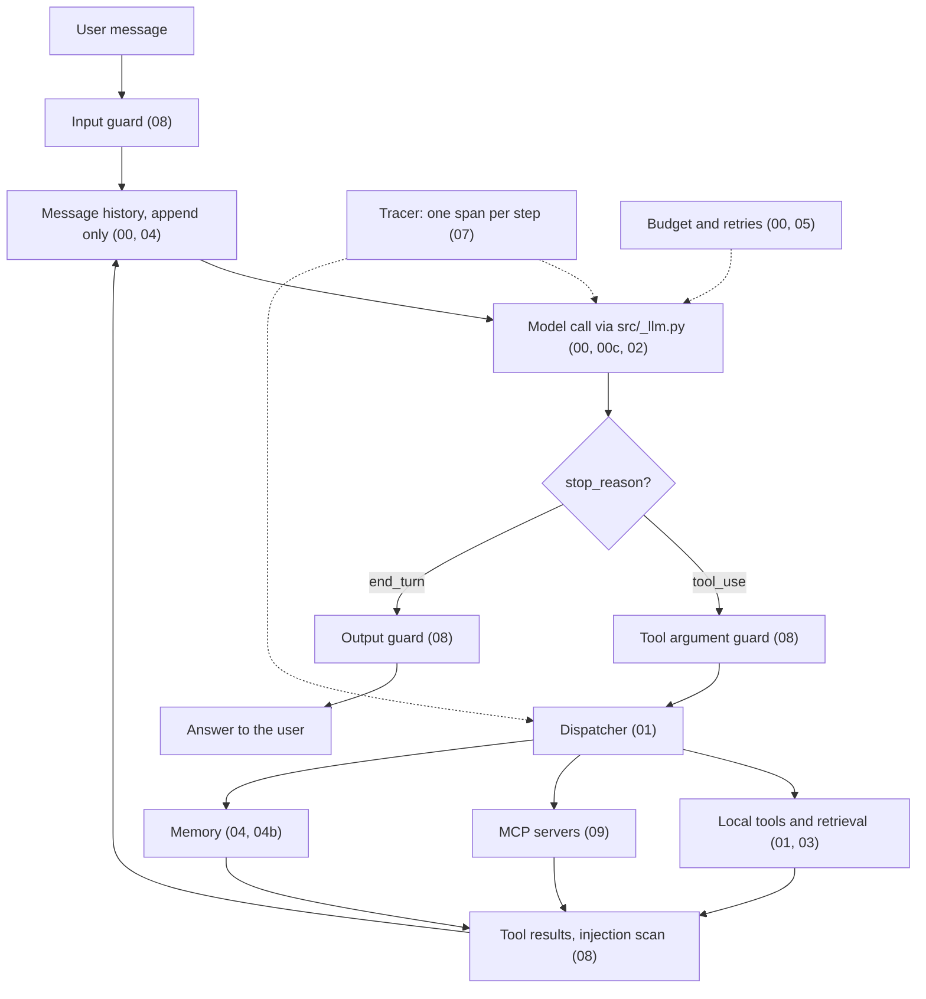

# Learn Agents: Agent Engineering from First Principles

A hands on course that teaches the engineering discipline of building LLM agents. Each lesson is one Markdown explainer + runnable Python code you can read, modify, and break.

**What this is:** A path from "I know Python" to "I can build a production agent" by *implementing* every concept yourself before reaching for a framework.

**The rule every lesson follows:** build it by hand first, then use the managed version. The Claude API now does a lot for you (structured outputs, streaming helpers, web search and code execution, compaction, tool search, whole agent harnesses). Each of those lessons first builds the mechanism from the primitives (a token loop, a tool call, a message list) or points to the earlier lesson that did, explains what the managed feature does under the hood, and only then shows the feature, so you know what you are renting and what it costs.

**What this is not:** A LangChain tutorial. A LangGraph tutorial. An Anthropic SDK tutorial. The lessons use Anthropic's SDK as a thin transport behind `src/_llm.py`, but the *patterns you learn* (tool dispatch, RAG, retries, MCP) apply to any model and any SDK.

## Learning path

| # | Lesson | What you'll build |
|---|---|---|
| 00 | [Mental model](lessons/00_mental_model/README.md) | The agent loop in 30 lines |
| 00b | [Context engineering](lessons/00b_context_engineering/README.md) | What goes into the context window each turn, and context rot |
| 00c | [Thinking and effort](lessons/00c_thinking_and_effort/README.md) | Adaptive thinking, thinking blocks, effort levels, what replaced budgets and temperature |
| 01 | [Tool / function calling](lessons/01_tool_calling/README.md) | A tool dispatcher with validation, parallel calls, strict tools |
| 01b | [Streaming](lessons/01b_streaming/README.md) | messages.stream, event types, thinking deltas, streamed tool loops with eager input streaming |
| 01c | [Server tools](lessons/01c_server_tools/README.md) | Web search, web fetch and code execution that run on Anthropic's side |
| 02 | [Structured outputs](lessons/02_structured_outputs/README.md) | Native structured outputs into Pydantic, with self repair |
| 02b | [Prompt caching](lessons/02b_prompt_caching/README.md) | Cache hits, cache invalidation, stable prefixes |
| 03a | [Retrieval basics](lessons/03a_retrieval_basics/README.md) | Chunking, TF IDF search, LLM reranking |
| 03b | [RAG in the loop](lessons/03b_rag_in_loop/README.md) | An agent that searches its own corpus |
| 03c | [Modern (agentic) RAG](lessons/03c_agentic_rag/README.md) | Hybrid BM25 search and iterative retrieval |
| 03d | [Documents and citations](lessons/03d_documents_and_citations/README.md) | Document and image input, the API's native citations |
| 04 | [Memory and state](lessons/04_memory_state/README.md) | Scratchpad → summarization → persistent KV |
| 04b | [Long running context](lessons/04b_long_running_context/README.md) | Compaction, context editing, the memory tool, task budgets |
| 05 | [Retries and errors](lessons/05_retries_errors/README.md) | Hand rolled backoff + self correcting loops |
| 06 | [Human in the loop](lessons/06_human_in_loop/README.md) | Approval gates and durable pause/resume |
| 07 | [Evaluation and tracing](lessons/07_eval_tracing/README.md) | JSONL traces, eval fixtures, LLM as judge |
| 08 | [Guardrails](lessons/08_guardrails/README.md) | Input, output, tool arg guards, and indirect prompt injection |
| 08b | [Coding agents](lessons/08b_coding_agents/README.md) | Text editor and bash tools behind a sandbox and a permission policy |
| 09 | [MCP and tool servers](lessons/09_mcp/README.md) | A stdio MCP server + client, and the API's MCP connector |
| 09b | [Multi agent orchestration](lessons/09b_multi_agent/README.md) | Orchestrator worker and evaluator optimizer |
| 09c | [Many tools](lessons/09c_many_tools/README.md) | Tool search, Skills, programmatic tool calling |
| 09d | [Multi agent systems](lessons/09d_multi_agent_systems/README.md) | Sub agents as tools and handoffs, parallel agents on a shared blackboard, a compliance reviewer, tracing, hop limits and agent card routing across agents |
| 10 | [Capstone](lessons/10_capstone/README.md) | A research agent that uses every prior topic |
| 10b | [Harnesses](lessons/10b_harnesses/README.md) | Where these patterns live: Tool Runner, Agent SDK, Managed Agents |

Lessons build on each other; do them in order.

## The architecture at a glance

Every agent in this course is the same loop with more parts plugged in. The core (Lessons 00 to 02) is a message list, one model call per turn through `src/_llm.py`, and a dispatcher that runs the tools the model asks for. Everything after that adds a module around the loop:



Solid arrows are the data path of one turn; dotted arrows are the modules that watch every step. The top level [`capstone/`](capstone/README.md) wires exactly these modules (MCP, memory, guardrails, tracing) into one end to end agent, reusing the lessons' own code, and each lesson README opens with a diagram of its own loop.

## Setup

This is a `uv` project. Python 3.13.

```powershell
# One-time: copy the example env and add your Anthropic key
Copy-Item .env.example .env
# Edit .env and set ANTHROPIC_API_KEY=sk-ant-...

# Sync deps
uv sync

# Run any lesson script
uv run python lessons/00_mental_model/01_loop.py
```

### Corporate network note

If `uv sync` fails with `invalid peer certificate: UnknownIssuer`, your network is intercepting TLS with a custom CA. Tell uv to trust the OS certificate store:

```powershell
[Environment]::SetEnvironmentVariable("UV_SYSTEM_CERTS", "true", "User")
# Then restart the shell. (Older uv versions call it UV_NATIVE_TLS.)
```

## How to read each lesson

1. Read the lesson's `README.md`: that's the concept.
2. Run the numbered Python files in order. Each is standalone.
3. Break something. Reread. Fix it.
4. Skim "Common misconceptions" and "Failure modes" at the bottom of each lesson.

## Cost

Lessons use `claude-haiku-5-5` by default ($0.10 per million input tokens, $0.50 per million output tokens). A full pass through the course costs well under $1 in API calls. Override the model with `LEARN_AGENTS_MODEL=claude-sonnet-5-5` (or `claude-opus-5-5`) in `.env` if you want sharper responses, and the default effort with `LEARN_AGENTS_EFFORT` (Lesson 00c). A few lessons name a stronger model where a feature or the task needs it (the judge in Lesson 07, some server tools); each says why.

## API and SDK versions

The course targets the Claude API as of November 2026: the `anthropic` Python SDK 2.x, which sends API version `2026-10-21`. Three things from that era show up everywhere:

* Current models **think by default**, and responses can start with `thinking` blocks. `src/_llm.py` keeps every block so tool loops can send them back unchanged.
* **`effort`** is the quality and cost knob. `temperature`, `top_p` and `top_k` are gone from this API version, and thinking budgets are gone from current models.
* **Structured outputs are native** (`output_config.format`, `client.messages.parse`). Forcing a tool call with `tool_choice` returns a 400 on the newest models.

## Repository layout

```
Learn Agents/
├── README.md              ← you are here
├── .env.example           ← copy to .env
├── pyproject.toml
├── src/
│   └── _llm.py            ← the thin wrapper. The only place SDK calls live.
├── data/
│   └── corpus/            ← small text corpus for RAG lessons
├── capstone/              ← the modules wired into one end to end agent
└── lessons/
    ├── 00_mental_model/   ← each lesson is a dir with README.md + .py files
    ├── 01_tool_calling/
    └── ...
```
