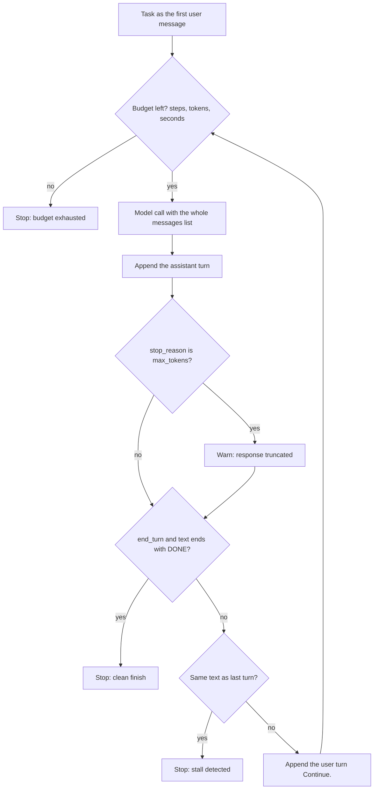

# Lesson 00: The Mental Model

Before any tools, schemas, retries, or RAG, there is one shape you need in your head. Everything in this course is a variation on it.

> **An agent is: an LLM + a loop + tools + a stop condition.**

That sentence is the whole course. The remaining lessons are detailed answers to questions about each of those four words.

## The loop at a glance



This is `02_loop_with_budget.py`. The budget check comes first, before any money is spent, and every path either stops or appends to `messages` and goes round again. `01_loop.py` is the same loop with only the step cap and the `DONE` check; tools join the loop in Lesson 01.

## The LLM is a pure function

An LLM, as exposed by any provider's API, is a stateless function:

```
messages  ->  message
```

You hand it a list of past messages. It hands you one new message back. It has **no memory** of your previous call, **no side effects**, **no agency**. The next call is independent unless *you* pass it the same conversation history again.

This matters because newcomers usually have one of two wrong mental models:

- **"The model is a chatbot that remembers me."** It doesn't. The chat UI you used remembered the history *for you* and sent again it.
- **"The model decides to call my function."** It doesn't. It emits text that *describes* a function call. Your code parses the text and decides whether to actually invoke anything.

Internalizing "the model is a pure function" reframes every later question. Memory? You build it. Tool dispatch? You build it. Retries? You build them.

## The loop

A single LLM call is not an agent. An agent calls the model **repeatedly**, with each turn's output influencing the next turn's input, until some stop condition fires. The skeleton:

```
messages = [first user message]
while not done(messages):
    response = llm.chat(messages)
    messages.append(response)
    if response wants a tool:
        result = run_tool(response.tool_call)
        messages.append(result)
```

That's it. ~10 lines of pseudocode is the load bearing structure of every agent you'll ever build. Frameworks like LangChain, LangGraph, AutoGen, CrewAI are convenience layers around that loop with extra ceremony for graph topology, retries, state stores, multi agent orchestration. Knowing the bare loop means you can read framework code and recognize what it's doing: instead of cargo culting.

## Tools

Tools are how the model causes effects in the world. A tool is **a function + a schema describing it**. You send the schema along with the messages. The model, if it decides a tool is needed, emits a `tool_use` block: a structured request that names the tool and the arguments to call it with.

Your runtime then:

1. Receives the `tool_use` block.
2. Validates the arguments against your schema (the model lies sometimes).
3. Calls the actual Python function.
4. Sends the result back as a `tool_result` message.
5. Loops.

Tool calling is its own lesson (01). For now: tools are how agents leave the prompt and do things.

## The stop condition

This is the most underdiscussed piece of agent design. A loop without a stop condition is either an infinite loop or a runaway bill.

Common stop conditions:
- The model returns text with no tool calls (it considers itself done).
- A specific tool was called (e.g., `submit_answer`).
- Step budget exhausted (`max_steps`).
- Token or wall clock budget exhausted.
- The output passes a structural check (e.g., parses as the target schema).

Real agents have **multiple** stop conditions, all firing as guards. The lesson here is to always have at least one budget based stop. You will write loops that go wrong. You want them to go wrong cheaply.

## Why every later lesson exists

Now you can predict what's coming and why:

| Concern | Why it exists |
|---|---|
| **Tool calling** (01) | Tools are how the agent does anything besides talk |
| **Structured outputs** (02) | The loop's output has to be parseable to be useful |
| **Retrieval / RAG** (03) | The agent needs facts that aren't in its weights |
| **Memory** (04) | The model is stateless: *you* are responsible for continuity |
| **Retries** (05) | Every step in the loop fails sometimes |
| **Human in the loop** (06) | Some tool calls are too consequential to auto run |
| **Evaluation** (07) | If you can't measure it, you can't trust it |
| **Guardrails** (08) | The model will say things you don't want it to |
| **MCP** (09) | Tool catalogs grow; share them like services |

## Failure modes to remember

The three places agents fall over:

1. **Model output is wrong or malformed.** Hallucinated tool names, broken JSON, lies about facts.
2. **Tool execution fails.** Timeout, crash, rate limit, third party 500.
3. **Control flow goes off the rails.** Infinite loops, the same tool called 30 times, no progress.

Every later lesson is a defense against one or more of these.

## Hands on

Two files. Run them in order.

### `01_loop.py`: the bare loop

A `run_agent` function in ~40 lines. No tools. The stop condition is "the assistant said the word `DONE`." You give it a task; it iterates until it self declares done. The point is to see the scaffolding.

```powershell
uv run python lessons/00_mental_model/01_loop.py
```

### `02_loop_with_budget.py`: layered stop conditions

Builds on `01_loop.py` with **four** stop signals in priority order:

1. **Budget** (`max_steps` / `max_seconds` / `max_input_tokens`): the hard, anti runaway stop. Checked *before* each LLM call so you don't pay for a doomed turn.
2. **`stop_reason == "end_turn"`**: the model's own graceful "my turn is over" signal. **Universal across providers** (Anthropic calls it `end_turn`; OpenAI calls it `"stop"`; Gemini `"STOP"`). The names differ; the concept is identical. In this demo it stops the loop only together with `DONE` (see below).
3. **Stall detector**: same response text two turns in a row. Without this, a stuck model can pile up turns until the budget catches it; cheaper to detect locally.
4. **`max_tokens`** is *not* a done signal: it means the response was truncated. We log a warning and continue (a real agent might reprompt with a smaller request).

The file also keeps the `DONE` keyword convention from `01_loop.py` as a *task specific explicit marker*, and here it is needed. `end_turn` says the model finished its *turn*, not the *task*. In a tool loop (Lesson 01) the two coincide: a turn that ends without a tool call is the final answer, so `end_turn` alone stops the loop. This demo has no tools and asks for one item per turn, so every turn ends with `end_turn` and the loop answers each one with `Continue.`; stopping on `end_turn` alone would end after the first name. So the graceful stop is `end_turn` **and** `DONE`, and a `DONE` in a truncated turn does not count. The pedagogy: **always have a hard budget; layer cheaper graceful stops on top.**

What you should see: the task asks for 6 names with `max_steps=4`, so steps 1 to 4 each print one name with `stop_reason=end_turn`, then `[stop] budget exhausted: max_steps=4`. Raise `max_steps` to 7 to see the graceful path: six names, the last turn ends with `DONE`, and `[stop] end_turn + assistant said DONE` fires before the budget.

```powershell
uv run python lessons/00_mental_model/02_loop_with_budget.py
```

## Key takeaways

- LLM = stateless pure function. You build everything around it.
- Agent = LLM + loop + tools + stop condition.
- Frameworks are conveniences over ~30 lines of loop. Build the 30 lines once.
- Every loop must have a budget based stop, even the smallest demo.
- Three failure axes: model output, tool execution, control flow. Every later lesson hardens one of these.

## Common misconceptions

- **"The model calls my function."** No: it emits a description; *your* code calls it.
- **"Agents are LangChain."** Frameworks abstract the loop. The loop is the thing.
- **"More tools = better agent."** Past ~10 tools, model accuracy on tool *selection* degrades. Curate.

Next: [Lesson 00b: Context engineering](../00b_context_engineering/README.md).
