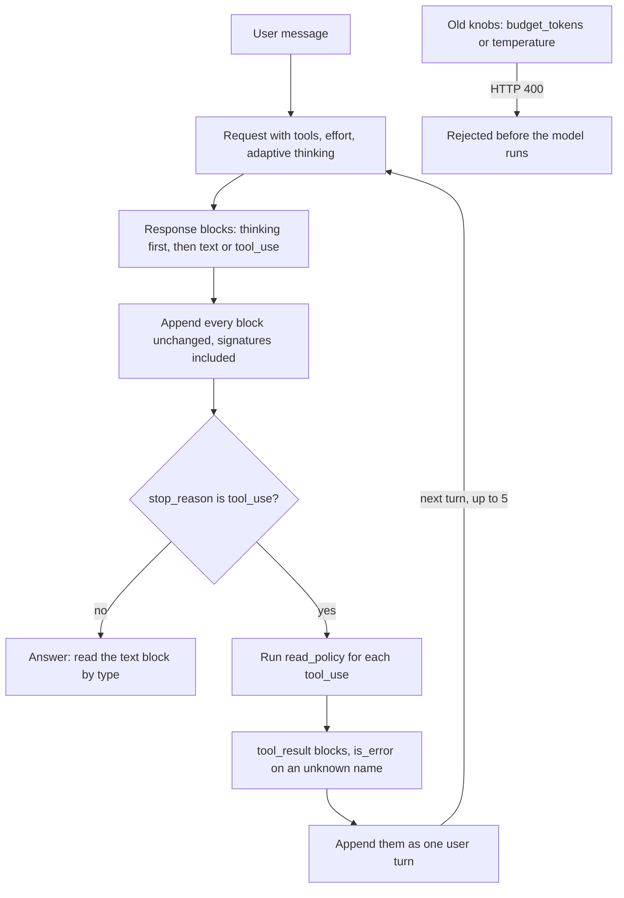

# Lesson 00c: Thinking and Effort

Lesson 00b showed that current models think between tool calls. This lesson is about the two settings that control that thinking, and with it most of your quality, latency and cost: **adaptive thinking** and **effort**.

> On current Claude models you no longer tune a thinking budget or a temperature. You pick an effort level, and the model decides how much to think.

Every later lesson runs on these defaults, so it pays to see them once with your own eyes.

## The loop at a glance



This is the tool loop of `02_see_the_thinking.py`. Watch the append step: thinking blocks go back exactly as they came, even when their text is empty, because the next request checks their signatures. The side branch is `03_old_knobs_fail.py`: the old settings never reach the model.

## What thinking is, mechanically

Start from Lesson 00: the model produces text one token at a time, and each token is conditioned on everything before it. "Thinking" is nothing more exotic than letting the model produce tokens *before* the answer that the answer can then condition on: working, checking, planning. A model trained to do this well spends those tokens where they help. You could approximate it yourself with a prompt ("reason step by step inside `<scratch>` tags, then answer") and a parser that cuts the scratch part out; that was the state of the art before reasoning models.

What the API adds on top of that idea:

- **A separate block.** Thinking tokens come back in their own `thinking` content block, so your code never confuses reasoning with the answer.
- **A signature.** Each block carries a `signature`: a check the API computes over the block and, on current models, over the conversation before it. You cannot read the raw reasoning (by default you get an empty text or, on request, a summary), and you cannot forge or edit it: when you send the block back, the API verifies the signature. That is why blocks must go back unchanged and why editing earlier turns breaks them (Lesson 04).
- **A trained budget sense.** Effort is not a hard cap like `max_tokens`; it is an instruction the model was trained to follow about how much work a request deserves. The hard caps stay yours: `max_tokens` per response, and your own loop budget (Lesson 05).

## Adaptive thinking is on by default

Current models (Claude Haiku 5.5, Claude Opus 5.5 and their peers) think before they answer even when the request never mentions thinking. The model decides per request how much thinking it needs, and it can skip thinking entirely on easy requests. That is **adaptive** thinking: `thinking: {"type": "adaptive"}`, which is also what you get by leaving `thinking` out.

Four consequences for your code:

1. **A response can start with `thinking` blocks.** `response.content` is a list of blocks: `thinking`, then `text` or `tool_use`. Code that reads `response.content[0].text` breaks. Read blocks by `type`, never by position. The helper in `src/_llm.py` does this for you (`.text`, `.tool_uses`, `.thinking`).
2. **Thinking counts toward `max_tokens`.** A cap sized for a one word answer, say `max_tokens=50`, can be used up by thinking, and the response then stops with `stop_reason: "max_tokens"` before any text. Leave room, or lower the effort.
3. **Thinking text is omitted by default.** Each thinking block comes back with an empty `thinking` field and a `signature`. To read a summary of the reasoning, ask for it with `thinking: {"type": "adaptive", "display": "summarized"}`. The other value, `"omitted"`, is the default on current models.
4. **Thinking blocks go back unchanged.** In a tool loop you append the assistant turn exactly as it came back, thinking blocks and signatures included, even when their text is empty. A serializer that skips empty blocks, or code that edits earlier turns, breaks the chain: the API rejects the request or the model loses the reasoning that led to its tool call.

```python
response = chat(messages, tools=TOOLS, thinking={"type": "adaptive", "display": "summarized"})
messages.append({"role": "assistant", "content": response.content})  # every block, as is
```

You pay for thinking as output tokens whether or not you see the text. `display` changes what you can read, not what you are billed.

## Effort: the main knob

`output_config.effort` sets how hard the model works: how much it thinks, how thorough its answer is, how many tool calls it is willing to make.

| Level | Use it for |
|---|---|
| `low` | Chat, classification, short tool tasks, high volume routes. Fastest and cheapest. |
| `medium` | Most work, including agent loops. The default on Claude Haiku 5.5 and Claude Opus 5.5. |
| `high` | Knowledge work, longer agent tasks, strict instruction following. The default on most other current models. |
| `xhigh` | Hard problems where your evals show a gain worth the cost. |
| `max` | The ceiling. Thinking and answers get much longer. |

```python
chat(messages, effort="low")
# raw SDK: client().messages.create(..., output_config={"effort": "low"})
```

Two rules of thumb:

- **To get less thinking, lower the effort.** Telling the model "answer directly, do not think" in the prompt does not reliably stop it thinking. The effort level does.
- **Choose by measurement.** Run two or three levels on your own test cases and keep the lowest one that passes. Lesson 07 builds the eval harness for this.

Changing the top level effort between requests also changes the request prefix, so it invalidates the prompt cache (Lesson 02b) for the messages. Pick a level per route and keep it stable.

## What effort replaced

Two older knobs are gone on current models:

- **`budget_tokens`.** Older models took `thinking: {"type": "enabled", "budget_tokens": N}`. On current models that returns HTTP 400. Use adaptive thinking and an effort level instead; where a small budget saved tokens, choose a lower level.
- **Sampling parameters.** `temperature`, `top_p` and `top_k` are removed in API version `2026-10-21`, which SDK `anthropic` 2.6.0 sends. Any value of any of them returns 400, and the SDK no longer has them as parameters. `temperature=0` for "deterministic" classification was the common use: replace it with a tighter prompt and structured output (Lesson 02), which constrains the answer far more than a sampling setting ever did.

## Hands on

### `01_effort_sweep.py`

The same multi step expense question (caps, a city exception, receipt and approval rules from the Acme handbook) at `low`, `medium` and `high`. Prints time, output tokens, the number of thinking blocks and the first part of each answer. Watch tokens and time grow with the level, and check whether the answer actually changes.

### `02_see_the_thinking.py`

Part 1 asks one question with the default display, then with `display: "summarized"`: the same thinking blocks, first empty with only a signature, then with a readable summary. Part 2 runs a small tool loop over the handbook and appends every assistant turn unchanged, then counts the thinking blocks carried in the history.

### `03_old_knobs_fail.py`

Sends a thinking budget and a `temperature` and prints the 400 each one gets, then sends the modern request: no `thinking` field, `effort: "low"`. Prints the block types of the answer so you can see whether the model thought at all.

## Key takeaways

- Current models think by default. Read blocks by type, size `max_tokens` with thinking in mind, and pass thinking blocks back unchanged.
- `display: "summarized"` lets you read the reasoning. The default `"omitted"` returns empty blocks with a signature. You pay for thinking either way.
- Effort (`low` to `max`) is the quality and cost knob. Defaults: `medium` on Claude Haiku 5.5 and Claude Opus 5.5, `high` on most others.
- `budget_tokens`, `temperature`, `top_p` and `top_k` return 400 on current models. Effort, prompts and structured output replace them.

## Common misconceptions

- **"No `thinking` field means no thinking."** Not any more. Leaving it out runs adaptive thinking on current models.
- **"An empty thinking block is junk I can drop."** It carries a signature the next request needs. Keep it.
- **"Higher effort is always better."** It is always slower and dearer. On simple tasks the answer is often the same at `low`.
- **"`temperature=0` makes answers repeatable."** It never guaranteed that, and now it is rejected. Repeatability comes from the prompt, structured output and your own validation.

Next: [Lesson 01: Tool / function calling](../01_tool_calling/README.md).
