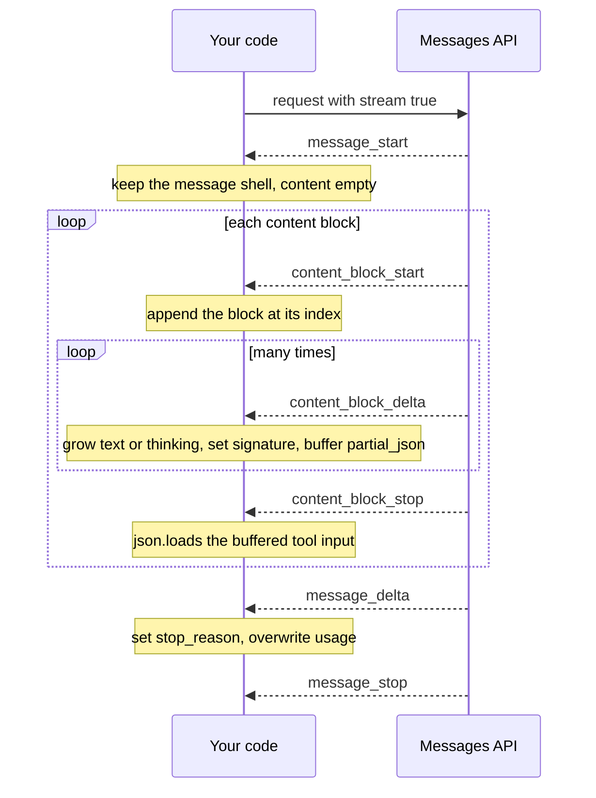

# Lesson 01b: Streaming

Every lesson so far waited for the whole response, then printed it. That works for a two line answer. It stops working when the answer is long, when a person is watching, or when the model is about to write a 20K token tool argument.

> Streaming does not make the model faster. It shows you the work as it happens, and it keeps long requests alive.

This lesson calls the SDK directly through `client()`, because `chat()` in `src/_llm.py` deliberately does not stream. It starts at the wire: you read the raw stream and build the message yourself. Only then does it hand the job to the SDK helper.

## The loop at a glance



This is the assembly `01_sse_by_hand.py` does by hand (it also skips `ping` events and raises on an `error` event). Notice where `stop_reason` arrives: second to last, so nothing before it tells you whether the turn is complete. `04_stream_tool_loop.py` then appends the finished message and runs the tools as in Lesson 01.

## Why stream

- **Time to first token.** A user who sees words after one second waits patiently for ten more. A user who sees a spinner for eleven seconds does not. The total time is the same; the experience is not.
- **Long outputs.** A long report or a big file body can take minutes. Streaming lets you print, save or cancel as it goes.
- **HTTP timeouts.** An idle connection that waits minutes for one big body can be dropped by a proxy or a load balancer. A stream sends events the whole time.
- **The SDK insists.** For a large `max_tokens` (roughly above 21K tokens with the default timeout) a non streamed `messages.create()` raises `ValueError` before it sends anything: such a request could run past ten minutes. Stream it, or set your own `timeout`. On current models outputs can reach 128K tokens, so this is not rare.

## What a stream is

Add `"stream": true` to the request body and the API answers with one long HTTP response of type `text/event-stream`: server sent events (SSE). The body is plain text, written a few lines at a time while the model generates:

```
event: message_start
data: {"type":"message_start","message":{"id":"msg_01...","content":[],"stop_reason":null,"usage":{"input_tokens":512,"output_tokens":1}}}

event: content_block_start
data: {"type":"content_block_start","index":0,"content_block":{"type":"text","text":""}}

event: content_block_delta
data: {"type":"content_block_delta","index":0,"delta":{"type":"text_delta","text":"Hello"}}

event: content_block_stop
data: {"type":"content_block_stop","index":0}

event: message_delta
data: {"type":"message_delta","delta":{"stop_reason":"end_turn"},"usage":{"output_tokens":12}}

event: message_stop
data: {"type":"message_stop"}
```

The rules fit in four lines: `event:` names the event, `data:` carries its JSON, a blank line ends the event, a line starting with `:` is a comment. Two names need care: `ping` is a keep alive with nothing in it, and `error` means the request failed in the middle of the stream, even though the HTTP status said 200.

## The event sequence

| Event | When | Carries |
|---|---|---|
| `message_start` | Once, first | The message shell: id, model, empty `content`, input token usage |
| `content_block_start` | Each block begins | `index` and the block with its `type`: `thinking`, `text`, `tool_use` |
| `content_block_delta` | Many times per block | `thinking_delta`, `signature_delta`, `text_delta` or `input_json_delta` |
| `content_block_stop` | Each block ends | `index` |
| `message_delta` | Once, near the end | `stop_reason`, final output token count |
| `message_stop` | Once, last | Nothing more |

Three things to notice:

1. **Thinking streams too.** On current models a response usually starts with a thinking block. With the default display (`"omitted"`) its deltas carry no text, so you see a pause before the first `text_delta`. With `thinking: {"type": "adaptive", "display": "summarized"}` you get `thinking_delta` events with a readable summary, which makes a good progress indicator.
2. **`stop_reason` arrives last.** You cannot know a turn was cut off at `max_tokens`, or refused, until `message_delta`. Do not act on a turn before the stream ends.
3. **Tool input arrives as pieces of a string.** Each `input_json_delta` carries a `partial_json` fragment such as `{"ci`, then `ty": "Tok`, then `yo"}`. No fragment is valid JSON on its own; only the joined string is, and only once `content_block_stop` says the block is done.

## Assembling a message by hand

With the format and the sequence known, rebuilding the message is a short loop:

1. Split the lines into events at each blank line and `json.loads` each `data:` payload. Skip `ping`, raise on `error`.
2. `message_start`: keep `message` as the shell. Its `content` is an empty list.
3. `content_block_start`: append the block; its position is the event's `index`.
4. `content_block_delta`: find the block by `index` and grow it. Append `text` and `thinking`, set `signature`, and collect `partial_json` strings per index in a separate buffer.
5. `content_block_stop`: if that index has collected tool JSON, `json.loads` it now and set it as the block's `input`.
6. `message_delta`: copy `stop_reason`, and overwrite the usage counts (they are running totals, not increments).

The result is the same `content`, `stop_reason` and `usage` that a non streamed `create()` returns. `01_sse_by_hand.py` does exactly this, about forty lines, and then proves it by feeding the same bytes to the SDK's own parser.

## The helper does this for you: `messages.stream()`

Now that you know what is underneath, let the SDK do it:

```python
with client().messages.stream(model=DEFAULT_MODEL, max_tokens=8000, messages=messages) as stream:
    for text in stream.text_stream:
        print(text, end="", flush=True)
    final = stream.get_final_message()
```

- It sends `stream: true`, reads the lines, groups them into events and parses each into a typed object: your step 1.
- `get_final_message()` returns the complete `Message` it grew from the deltas: your steps 2 to 6. Use it for everything after the stream rather than your own assembly; it also covers block types this lesson does not show.
- `text_stream` yields only the `text_delta` pieces. Thinking and tool input are skipped.
- Iterating the stream itself (`for event in stream`) gives the typed events from the table above. Next to them the helper yields convenience events, `text`, `thinking`, `signature` and `input_json`, each with the delta and the snapshot so far. They repeat what the deltas carry; use whichever reads better.
- The `with` block closes the connection, even if your loop breaks early.

Between the two sits `messages.create(..., stream=True)`: the SDK parses the SSE lines into typed events, but accumulates nothing and has no `get_final_message()`. Use the helper unless memory is tight.

## Streaming tool use

Tool calls stream as a `tool_use` block whose input arrives as the `input_json_delta` fragments you joined by hand. By default the API buffers and validates each argument before sending any of it, so a long argument (a file body, a document) arrives after a silent gap.

Setting `eager_input_streaming: True` on a client tool removes that buffering for that tool: the fragments stream as they are generated. Set it on your own tools whenever you stream with tools. Do not set it on server tools, where it is not a valid field.

What you give up is the validation, so a streamed tool loop needs three guards:

1. **Check `stop_reason` before running anything.** On `"max_tokens"` with a `tool_use` present, the input was cut off, and it usually still parses as a valid looking partial object. On `"refusal"`, a tool call may have been cut short. Run no tools in either case.
2. **Validate every input yourself.** Your hand parser calls `json.loads` once on the whole string and fails loudly. The SDK instead parses the fragments as they come with a tolerant parser, so malformed JSON can come back as a silently truncated object rather than an error. Validate against your schema (a pydantic model, as in Lesson 01) and send failures back as `is_error` tool results.
3. **Catch `ValueError` around the stream.** JSON the SDK cannot parse at all raises `ValueError` from the stream iterator, so wrap the whole `with` block, retry the turn a bounded number of times, and let API errors (rate limits, auth) propagate.

After the stream ends, the loop is the same as before: append `final.content` as the assistant turn, every block unchanged (thinking blocks with their signatures, text, tool use), then a user turn with the tool results. Streaming changes how you watch a turn, not what goes into the history.

## Hands on

### `01_sse_by_hand.py`

Requests a stream with no helper: `client().messages.with_streaming_response.create(..., stream=True)` hands back the HTTP response unread, and `iter_lines()` gives its body line by line. Part 1 prints every raw `event:` and `data:` line as it arrives. Part 2 parses them by hand (`read_sse()` groups the lines into events, `assemble()` grows the message) and prints the thinking, text and `tool_use` blocks, the tool input decoded at `content_block_stop`, the stop reason and the usage. Part 3 hands the same bytes to the classes `messages.stream()` uses and checks that `get_final_message()` gives the same id, model, content, stop reason and usage. The request offers one tool, so you see `partial_json` pieces; the tool is never run.

### `02_stream_text.py`

Part 1 asks for `max_tokens=64000` without streaming and prints the `ValueError` the SDK raises before sending anything. Part 2 streams a welcome letter from the onboarding handbook with `text_stream`, then prints the time to the first text piece, the total time, and the block types, stop reason and token count from `get_final_message()`.

### `03_stream_events.py`

Streams one short answer with summarized thinking through the helper and prints every typed event with its arrival time, collapsing runs of identical deltas into one line with a count. Watch the thinking deltas come first, the text deltas after, and `stop_reason` only in `message_delta`. It also counts the SDK's convenience events.

### `04_stream_tool_loop.py`

A two tool loop over the Acme handbook (`read_policy`, `save_note`) with `eager_input_streaming: True`. Text and tool input fragments print as they arrive; the note body visibly streams into the `save_note` call. Each turn checks `stop_reason`, validates input with pydantic, guards against `ValueError`, and appends the full final message to the history.

## Key takeaways

- A stream is one long HTTP response of `event:` and `data:` lines. Every helper above it only parses those lines and accumulates the deltas.
- Events: `message_start`, then per block `content_block_start`, deltas, `content_block_stop`, then `message_delta` with `stop_reason`, then `message_stop`.
- Tool input is a string in pieces: join the `partial_json` fragments per block and parse them at `content_block_stop`.
- Stream whenever a person is watching or the output is long. The SDK refuses non streamed requests with a large `max_tokens`.
- Once you know the mechanism, use `messages.stream()` plus `get_final_message()`: live output and the complete message. Print with `flush=True`.
- With tools, set `eager_input_streaming: True` on your own tools, check `stop_reason` before running anything, and validate every input yourself.
- The history gets the full final message, exactly as in a non streamed loop.

## Common misconceptions

- **"Streaming makes responses cheaper or faster."** Same tokens, same price, same total time. It only changes when you see them.
- **"Streaming is a special protocol I need a library for."** It is plain HTTP with text lines; you parsed it with `json.loads` and a loop. The library saves you the edge cases, not a secret.
- **"`text_stream` is the whole response."** It skips thinking and tool calls. Read `get_final_message().content` for those.
- **"Each `partial_json` piece is a small JSON object."** It is a fragment of one JSON string, cut anywhere. Only the joined string parses.
- **"If it parsed, the tool input is complete."** With eager streaming a truncated input often parses fine. `stop_reason` and your own validation are what catch it.
- **"I can append the text I printed as the assistant turn."** That drops the thinking and tool use blocks. Append `final.content`.

Next: [Lesson 01c: Server tools](../01c_server_tools/README.md).
