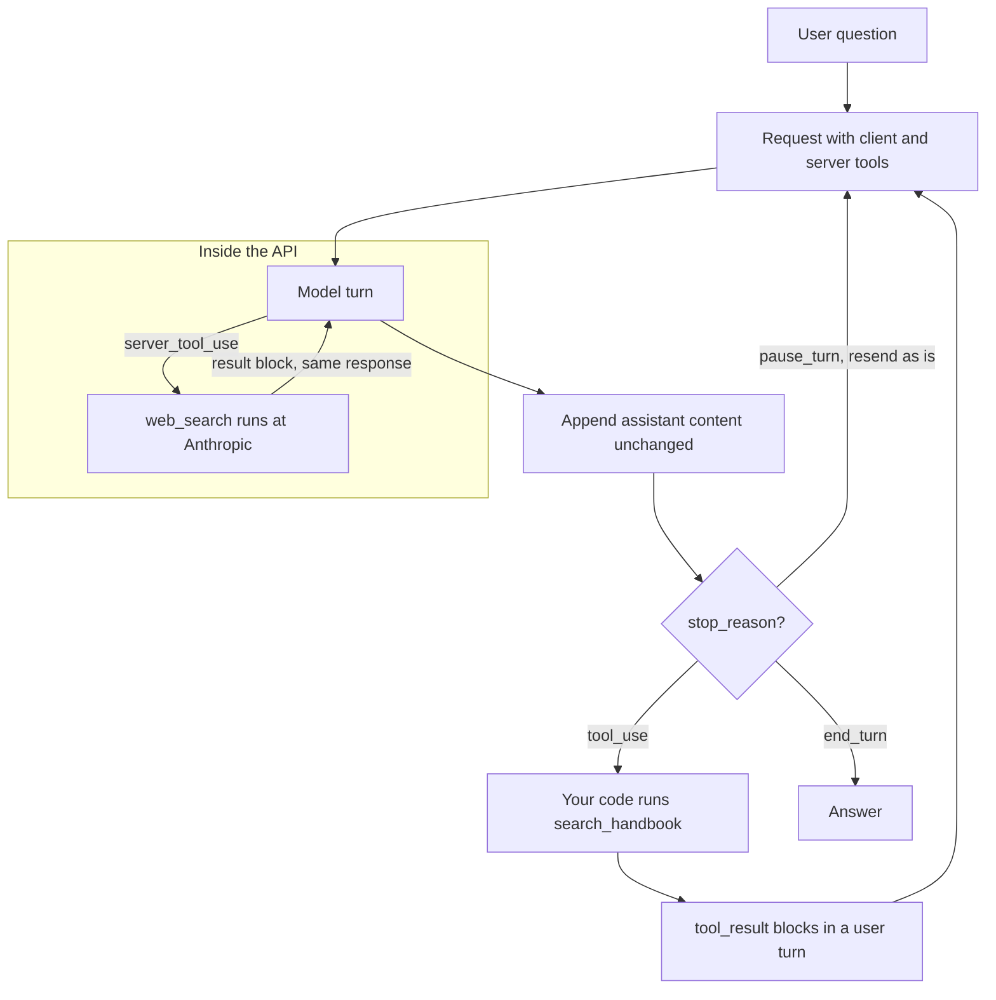

# Lesson 01c: Server Tools

In Lesson 01 every tool was yours: you wrote the function, validated the arguments, ran it, and sent a `tool_result` back. That is a **client tool**. The model only ever asks; your code does the work.

Anthropic also offers tools it runs for you: web search, web fetch and code execution. Before renting them, build the same two capabilities yourself with the Lesson 01 loop. Then you know exactly what the server versions do, what they save you, and what they cannot do.

## The loop at a glance



This is the loop of `04_mixed_client_and_server.py`. The server tool never reaches your code: its call and its result arrive inside the same response. Only `tool_use` sends work your way, and `pause_turn` is answered by sending the same request again, with no new user message. When both kinds are asked for in one turn, the server call waits and runs at the start of the next request.

## Part 1: build it yourself

`01_build_your_own.py` adds two ordinary client tools to the Lesson 01 registry and dispatcher. Nothing in the loop changes. Each tool is a pydantic model, a function and a description.

### `fetch_url(url)`: reading the web

An HTTP GET with `urllib.request` from the standard library, plus the guards any fetch tool needs:

- **A domain allowlist.** Only `python.org` and its subdomains. The host is checked again after redirects, because a redirect can carry the request anywhere.
- **Only `http` and `https`.** A `file://` URL would read your own disk.
- **A timeout, a byte cap and a character cap.** A slow server stalls the loop; a huge page fills the context and the bill.
- **HTML to plain text** by a crude tag strip (drop `script` and `style`, drop tags, collapse whitespace).
- **Errors as `is_error` tool results.** A blocked domain, a 404 or a timeout goes back to the model as text it can read and work around, exactly like Lesson 01.

What it lacks is what a web *search* tool is made of:

- **A search index.** `fetch_url` needs a URL. Finding the right page among billions means crawling and indexing the web.
- **Ranking.** Deciding which pages answer the question is most of a search engine's value, and years of work.
- **Freshness.** An index is recrawled continuously. Your fetch sees one page, once.
- **Robust reading.** No JavaScript (python.org's own page says its interactive scripts did not run), no PDF, no caching, no politeness limits per site.

Fetching a page is a few lines. Search quality is the part worth renting.

### `run_python(code)`: running the model's code

The model writes a script; the tool runs it with `subprocess`:

- **A fresh temporary folder** per call, deleted afterwards. No state carries over between calls.
- **`sys.executable -I`**: your own interpreter in isolated mode, which ignores `PYTHON*` variables, the user site folder and the current folder on `sys.path`.
- **A minimal `env`.** The child inherits no API keys, tokens or proxy credentials. On Windows only `SYSTEMROOT` is passed through, because Python needs it to start.
- **No shell, a timeout, an output cap.** An endless loop is killed after 10 seconds and comes back as an `is_error` result.
- **Approval before every run** (Lesson 06): the script is printed and you answer `y` or `n`. `--yes` skips the prompt. A declined run is an `is_error` result, not a crash.
- **The same result shape as the server tool**: `return_code`, `stdout`, `stderr`.

What it does **not** isolate, and this is the important part:

- **Filesystem.** The code runs as you. It can read your home folder, your SSH keys and this repository, and delete anything you can delete.
- **Network.** It can open sockets and send what it read anywhere.
- **CPU, memory, processes.** The timeout stops the main process. A child process it started, a memory bomb or a full disk are not stopped.

Approval is the only real guard here, and it only works while a person reads every script. A real sandbox is a container or a virtual machine: its own filesystem, no network, quotas, thrown away after use (Lesson 08b says the same for coding agents). Building and operating that is exactly what the code execution server tool does for you.

### What the two tools show

- **A tool is just your code behind a schema.** The model part is trivial: a name, a description, a JSON schema, a dispatcher. Both tools went through the same `dispatch()` as `get_weather` in Lesson 01.
- **The hard parts are not the call.** They are isolation (what the code can touch), search quality (which page to read), and limits (time, bytes, domains, cost). Those are what you pay for when you use a server tool.

Run `01_build_your_own.py --check` to exercise both tools without an API key: a snippet, an endless loop, a blocked domain, a `file://` URL and python.org.

## Part 2: what changes when Anthropic runs it

A **server tool** is the other kind. Anthropic wrote it and Anthropic runs it. You declare it in `tools` with a dated `type` string and no schema, and the API executes it inside the same request. The calls and their results come back as content blocks in the response you already get. No dispatcher, no `tool_result`, no second request.

Three server tools cover most needs:

- **Web search** (`web_search`): runs queries against a web search index, returns ranked results, and Claude answers with citations to the pages. This is the index, ranking and freshness `fetch_url` lacks.
- **Web fetch** (`web_fetch`): reads the full text of a URL (HTML, text, or PDF). The server version of `fetch_url`.
- **Code execution** (`code_execution`): a sandboxed Linux container where Claude runs Bash and Python and edits files. The isolation `run_python` lacks.

The loop shape stays the same: the model still decides when to call a tool, and a tool call is still a block with an id and an input. What moves:

| | `01_build_your_own.py` | Server tool |
|---|---|---|
| Where it runs | Your process, as you | Anthropic's infrastructure, in a container with no network (code execution) |
| When the result arrives | In your next request, as a `tool_result` you build | In the same response, as a result block the server built |
| Long work | Your loop, your step budget | The server loops; on a long turn it stops with `pause_turn` and you resend |
| Errors | Your `is_error` result | A result block with an `error_code`, inside an HTTP 200 |
| Limits | Your constants (timeout, byte cap, allowlist) | Tool settings: `max_uses`, `allowed_domains`, `max_content_tokens`, the container's time limit |
| Cost | Your machine, your bandwidth | Billed per search or per container hour, plus every result as input tokens |
| Privacy | Data stays on your machine | Queries, URLs and code leave your network |

The rest of this lesson covers those differences in detail. They change what you build, not how the loop thinks. The difference is who runs it, who pays for it, and where your data goes.

## Client tools vs server tools

| | Client tool (Lesson 01) | Server tool (this lesson) |
|---|---|---|
| Who defines it | You: name, description, `input_schema` | Anthropic: you pick a `type` such as `web_search_20260209` |
| Who runs it | Your process | Anthropic's infrastructure |
| What the model emits | `tool_use` (id starts `toolu_`) | `server_tool_use` (id starts `srvtoolu_`) |
| Where the result appears | In *your* next user message, as `tool_result` | In the *same* response, right after the call (`web_search_tool_result`, `bash_code_execution_tool_result`, ...) |
| `stop_reason` while working | `tool_use`: your turn | none; the server loops internally, or `pause_turn` on a long turn |
| Errors | Your dispatcher returns `is_error: true` | A result block with an `error_code`, inside an HTTP 200 |
| Can reach your private data | Yes | No |

## Declaring them

A server tool entry is just a `type` and a fixed `name`, plus optional settings:

```python
tools = [
    {"type": "web_search_20260209", "name": "web_search", "max_uses": 3},
    {"type": "web_fetch_20260209", "name": "web_fetch", "max_content_tokens": 20000},
    {"type": "code_execution_20260521", "name": "code_execution"},
]
```

The date in the `type` is a version. Older versions stay available, so pick the one with the capability you need:

| Tool | Versions | What the newer ones add |
|---|---|---|
| Web search | `web_search_20250305`, `web_search_20260209`, `web_search_20260318` | `20260209`: dynamic filtering. `20260318`: `response_inclusion` |
| Web fetch | `web_fetch_20250910`, `web_fetch_20260209`, `web_fetch_20260309`, `web_fetch_20260318` | `20260209`: dynamic filtering. `20260309`: `use_cache` to bypass the fetch cache. `20260318`: `response_inclusion` |
| Code execution | `code_execution_20250825`, `code_execution_20260120`, `code_execution_20260521` | `20260120`: REPL state and programmatic tool calling. `20260521`: tells Claude about the 90 second limit per Python cell |

### Which model takes which version

All three tool pages list `claude-haiku-5-5`, the course default, as a supported model, and every supported model accepts all three code execution versions. The scripts therefore use the default model.

**Dynamic filtering** is the one wrinkle. With `web_search_20260209` and later (and the matching `web_fetch` versions), Claude can write code that filters search results *before* they enter its context, which saves tokens on search heavy work. It works by calling the search from inside code execution, so the tool's `allowed_callers` defaults to `["code_execution_20260120"]`. That needs a model with programmatic tool calling (Claude 4.6 and later models; Claude Haiku 5.5 gained it, Claude Haiku 4.5 does not). On a model without it, the API answers 400 and tells you to set `allowed_callers: ["direct"]`. Setting `"direct"` yourself also turns dynamic filtering off on purpose, which the scripts do so the blocks stay easy to read.

Some older quick references list only the Opus and Sonnet models for the `20260209` web tools. If a request fails on your model, check it from code instead of guessing: the Models API reports `capabilities.server_tools.web_search.supported` and `capabilities.server_tools.code_execution.supported` per model.

Platform matters too: on Google Cloud (Google managed) and Microsoft Foundry hosted on Azure only the basic `web_search_20250305` is available.

## What a response looks like

One request with web search can come back like this (thinking blocks left out):

```
text                    "I'll look that up."
server_tool_use         {name: "web_search", input: {query: "latest Python release"}, id: "srvtoolu_..."}
web_search_tool_result  {tool_use_id: "srvtoolu_...", content: [ {url, title, page_age, encrypted_content}, ... ]}
text                    "Python 3.x.y was released on ..."  citations: [{type: "web_search_result_location", url, title, cited_text}]
```

Three rules for that content:

1. **Send it back unchanged.** Search results carry `encrypted_content`, and citations carry `encrypted_index`. The API needs both on later turns; a modified or missing field is a 400. The helper in `src/_llm.py` keeps every block as a dict for exactly this reason.
2. **Read blocks by type, never by position.** The same response mixes text, thinking, calls and results.
3. **Never answer a `server_tool_use` with a `tool_result`.** Only `tool_use` blocks are yours.

## `pause_turn`: resend to continue

The server runs its own loop (search, read, search again). On a long turn it may stop early with `stop_reason: "pause_turn"`. That is not an error and not the end. To continue:

- Append the paused assistant content to `messages` exactly as received.
- Send the request again with the **same `tools`**. A paused turn can end on a `server_tool_use` whose tool has not run yet; without that tool the request is a 400.
- Do **not** add a "please continue" user message. The API sees the trailing call and resumes.
- With code execution, also send the `container` id from the response, or the resumed turn starts in a fresh container and loses its files.
- Cap the number of continuations, like any retry loop.

## Errors come back as blocks, with HTTP 200

A failed search does not raise. The request succeeds and the result block holds an error object instead of a list:

```json
{"type": "web_search_tool_result", "tool_use_id": "srvtoolu_...",
 "content": {"type": "web_search_tool_result_error", "error_code": "max_uses_exceeded"}}
```

Claude reads the error and carries on (often by answering with what it has). Your code should branch on the shape: a success `content` is a list, an error `content` is one object. A search with no hits is an empty list, not an error.

Common codes: web search has `max_uses_exceeded`, `too_many_requests`, `query_too_long`, `invalid_tool_input`, `unavailable`. Web fetch adds `url_not_allowed`, `url_not_in_prior_context`, `url_not_accessible`, `unsupported_content_type`. Code execution has `execution_time_exceeded` and `output_file_too_large`, and a script that fails normally is not an error at all: it is a result with a nonzero `return_code` and text in `stderr`.

A whole request still fails the usual way (an exception, Lesson 05) when the request itself is wrong: both domain lists set, an invalid domain, or web search switched off for your organization.

## Limits you set on the tool

- **`max_uses`**: the most calls in one turn. Failed calls count. Extra calls get a `max_uses_exceeded` result. Simple factual questions need 1 to 3 searches; comparisons can use 10 or more.
- **`allowed_domains` or `blocked_domains`** (never both): bare hostnames without a scheme, subdomains included (`example.com` covers `docs.example.com`). Web search accepts a path (`example.com/blog`); web fetch matches the domain only. Your organization's settings in the Console still apply on top.
- **`user_location`** (web search): an approximate city, region, country, or timezone for local results.
- **`max_content_tokens`** (web fetch): truncates long pages so one fetch cannot flood your context.

Web fetch has one more rule built in: it only fetches URLs that already appeared in the conversation (a user message, a client tool result, or an earlier search or fetch). Claude cannot invent a URL and fetch it. This is a guard against a prompt injection that tells the model to send your data to a URL of the attacker's choosing.

## Cost

| Tool | Price beyond tokens | Token effect |
|---|---|---|
| Web search | USD 10 per 1,000 searches (a failed search is free) | Every result is input tokens, this turn and every later turn |
| Web fetch | none | The fetched page is input tokens; cap it with `max_content_tokens` |
| Code execution | Billed by container time: 5 minute minimum, 1,550 free hours per organization per month, then USD 0.05 per hour. Free in a request that also declares a `20260209` or later web tool | Code, stdout and file views are tokens |

`usage.server_tool_use` on the raw response counts `web_search_requests` and `web_fetch_requests`. Because results live in the history, a long chat that searched early keeps paying for those results on every turn. Prompt caching (Lesson 02b) and short histories (Lesson 04) help.

## Privacy

- Search queries and fetched URLs leave your system. Website owners can log what was fetched, including URL parameters.
- Code execution is not eligible for Zero Data Retention: container data is kept up to 30 days. The basic web tools are ZDR eligible; dynamic filtering is not, because it uses code execution. Setting `allowed_callers: ["direct"]` makes the `20260209` web tools eligible again.
- Web fetch plus untrusted input plus sensitive data is a data exfiltration risk. Only enable it where that mix cannot happen, or restrict it with `allowed_domains`.
- Server tools cannot see your private systems. That is a safety property and a limitation.

## When to prefer a client tool you control

Use a server tool when the capability is generic (the public web, a scratch sandbox) and you would otherwise build and host it yourself. Write a client tool when:

- The data is private: your handbook, your database, your tickets. A server tool cannot reach it, and you would not want it to.
- You need control over the call: approval before it runs (Lesson 06), your own retries and timeouts, logging every argument (Lesson 07), or deterministic results for tests.
- You need a specific source or index, not "the web".
- Policy forbids the data leaving your network, or you need ZDR for every part.
- Cost needs a hard ceiling per user that `max_uses` alone does not give you.

Many agents mix both: client tools for private data, a server tool for the public world. `04_mixed_client_and_server.py` does exactly that.

## Mixing client and server tools in one turn

If Claude calls a client tool and a server tool in the same turn, the API does **not** run the server tool yet. It returns at once with `stop_reason: "tool_use"`. The response holds your `tool_use` block and a `server_tool_use` block with no result. There is no other marker: you detect it by a `server_tool_use` id with no matching result block. Run your client tools, send only the `tool_result` blocks back with the same `tools`, and the API runs the deferred server call at the start of the next response.

## Hands on

### `01_build_your_own.py`: the mechanism, by hand

`fetch_url` and `run_python` as client tools in the Lesson 01 dispatcher. Run 1 sends the same expense question as `03_code_execution.py` and asks before running each script (`--yes` skips the prompt). Run 2 asks about one allowed and one blocked URL, so you see an `is_error` result and the model working around it. `--check` runs the tools directly, with no API call. Compare its output with scripts 02 and 03: similar questions, a different place of execution.

### `02_web_search.py`: a tool you declare but never run

Two questions with web search. Prints every block by type so you see the `server_tool_use`, the result list, and text blocks whose citations name the source URLs. Run 2 limits search to `python.org` with `max_uses: 1`: any extra search shows up as a `max_uses_exceeded` result block, not an exception. Handles `pause_turn` by resending.

### `03_code_execution.py`: a sandbox you do not have to build

Gives Claude the Acme expense policy and one trip, and asks it to compute the reimbursable amounts with Python. Prints each command and its stdout and `return_code`. Uses the raw SDK client because it needs the response's `container` id to resume a paused turn. Ends with the same numbers computed locally: check the model's arithmetic.

### `04_mixed_client_and_server.py`: one loop, two kinds of tool

A client tool (`search_handbook`, runs here over the private corpus) and web search (runs at Anthropic) answer one question that needs both. The loop treats `pause_turn` (resend) and `tool_use` (run your tools) differently and prints which calls were deferred.

## Key takeaways

- A tool is your code behind a schema. Web fetch and code execution are a few lines each as client tools; the work is in the guards.
- A subprocess with a timeout and an empty environment is not a sandbox. Real isolation of filesystem, network and CPU needs a container or a virtual machine.
- Fetching a page is easy; finding and ranking the right page is what a search tool sells.
- A server tool is declared with a dated `type`, run by Anthropic, and returned in the same response.
- Never send a `tool_result` for a `server_tool_use`. Only `tool_use` blocks are yours.
- `pause_turn` means resend unchanged with the same tools (and the same container). It is not an error.
- Server tool errors are result blocks inside an HTTP 200. Branch on the content shape.
- Bound every server tool: `max_uses`, domain lists, `max_content_tokens`.
- Search results are billed per search and then again as input tokens on every later turn.
- Private data, approvals, audit and hard cost limits are reasons to keep a tool on the client.

## Common misconceptions

- **"My subprocess with a timeout is a sandbox."** It runs as you, with your files and your network. Only the operating system (a container, a virtual machine) can take those away.
- **"Web search is just fetch in a loop."** Without an index and ranking, the model has to guess URLs. The index is the product.
- **"Server tools are a different API."** They are tools in the same `tools` list of the same Messages call.
- **"If the search fails, I'll get an exception."** You get a 200 and an error block. Code that only catches exceptions never notices.
- **"`pause_turn` means the model is done."** It means the server stopped its loop early. Resend to finish.
- **"I can strip the encrypted fields to save space."** They are required on later turns. Strip them and the next request fails.
- **"Web fetch can read any page the model thinks of."** Only URLs already in the conversation, which is the point.
- **"Code execution can install anything from the internet."** The container has no network. Only the preinstalled libraries are there.

Next: [Lesson 02: Structured outputs](../02_structured_outputs/README.md).
