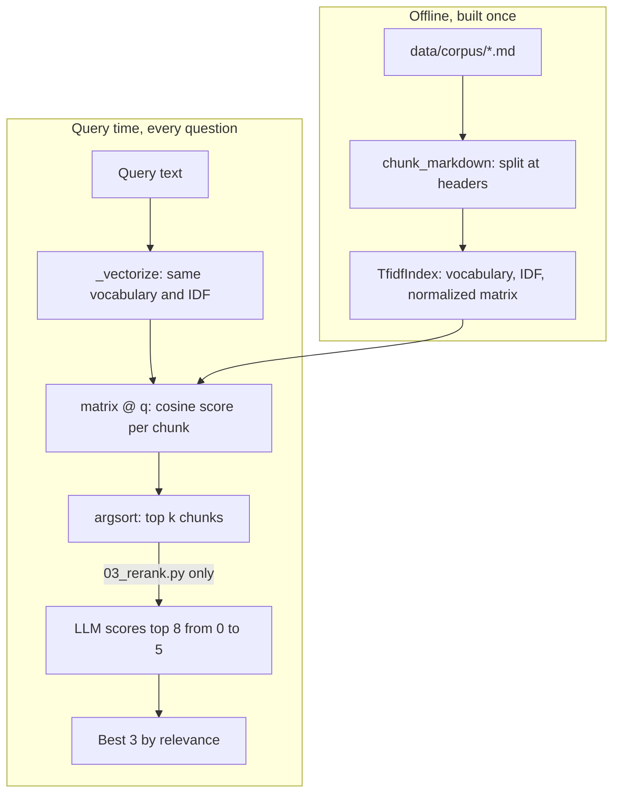

# Lesson 03a: Retrieval Basics

This is the first half of RAG ("retrieval augmented generation"). The agent doesn't have your company handbook in its training data. It has to **look things up**. The mechanics of "look things up" are what this lesson is about.

We will write a tiny search engine from scratch in ~40 lines of NumPy. No vector databases, no embedding APIs (yet). The point is to demystify the three stages every retrieval system has:

1. **Chunk** the corpus into searchable pieces.
2. **Index** the chunks as vectors.
3. **Retrieve** the top k closest chunks for a given query.

Once these are clear, swapping NumPy for Pinecone or TF-IDF for OpenAI embeddings is just changing the implementation behind a fixed interface. Lesson 03b does that swap.

## The loop at a glance



The top box runs once per corpus; the bottom box runs per question and only reads the matrix. The query goes through the same vocabulary and IDF as the chunks, which is why a word the corpus never uses simply drops out. When the words miss, the right chunk can still sit low in the list, so `03_rerank.py` fetches a wider top 8 and lets the model reorder them.

## Why not just stuff the whole corpus in the prompt?

Three reasons:

- **Cost.** Tokens are billed per call. A 50 page handbook sent again on every question is wasteful.
- **Latency.** More tokens in = slower response.
- **Quality.** "Lost in the middle": models attend less reliably to content in the middle of huge contexts. Targeted retrieval beats stuffed context for any nontrivial corpus.

For a single page of source material, dump it in and skip retrieval. For more than that, retrieve.

## Stage 1: Chunking

You can't search whole documents: they're too big to embed meaningfully and too big to fit many of them in a prompt. So you slice each document into **chunks** (a few hundred words each) and search over those.

Three common strategies, in order of sophistication:

- **Fixed size**: every N characters, sometimes with overlap. Trivial to implement; sometimes splits sentences mid clause.
- **Sentence/paragraph aware**: splits on punctuation or blank lines. Better preserves meaning units.
- **Structure aware**: splits on Markdown headers, code block boundaries, JSON keys. Best when the source has structure to exploit.

There is no universally best chunker. Empirically: structure aware > paragraph aware > fixed size, but the gap narrows as chunks shrink. The exercise in this lesson runs all three on the same corpus so you can eyeball the difference.

**Watch for:** a fact that gets split across two chunks ("The deadline is ... \[chunk boundary\] ... 30 days"). Retrieval will miss it. Mitigation: overlap consecutive chunks by 10 to 20%.

## Stage 2: Indexing: what's a "vector," anyway?

An embedding is a function `text -> R^d` (a vector of `d` numbers, typically 384 to 3072). Similar texts produce similar vectors. The "magic" of embeddings is that this similarity is *semantic*: "cancel my subscription" and "I want to unsubscribe" come out close, even though they share few words.

This lesson uses a much simpler embedding: **TF-IDF**. The vector for a chunk is a bag of words vector weighted by inverse document frequency. It captures **lexical** similarity (do the words overlap?) but not **semantic** similarity ("car" and "automobile" look different to TF-IDF).

Why start here? Because:

1. It's 40 lines of NumPy: you can read every line.
2. The retrieval pipeline (build matrix → query vector → cosine similarity → top k) is identical to what embedding based retrieval does.
3. The *bad* retrieval it produces motivates real embeddings in Lesson 03b.

## Stage 3: Retrieval: cosine similarity

Given a corpus matrix `M ∈ R^{N×d}` (N chunks, d features) and a query vector `q ∈ R^d`:

```
similarity[i] = (M[i] · q) / (||M[i]|| · ||q||)
top_k = argpartition(-similarity)[:k]
```

That's the whole game. Once embeddings exist, retrieval is a dot product. People sell vector databases that do this on billion row corpora; the math is the same.

## A note on "top k"

Top k is naive. Real systems usually do:

1. **Coarse retrieval**: cheap top k (TF-IDF or low dim embedding) → 50 candidates.
2. **Reranking**: more expensive cross encoder or LLM judge → top 5 from those 50.

The two stage pattern is standard. The 5 line "reranker" in this lesson is `03_rerank.py`: an LLM call that reorders candidates by relevance to the question.

## Failure modes

- **Chunk boundary splits a fact.** Add overlap.
- **Lexical retrieval misses paraphrases.** That's TF-IDF; upgrade to embeddings (Lesson 03b).
- **Top k always returns *something*, even when nothing matches.** Filter by similarity threshold, or have the model decide "no relevant context found."
- **Stale index.** Source docs changed; index didn't. Reembed on a schedule or on write.
- **Embedding model mismatch.** Index built with model A, queries with model B. Silent garbage. Pin the model id alongside the index.

## Hands on

### `01_chunking.py`

Three chunkers (fixed size, paragraph, markdown header) on our corpus in `data/corpus/`. Print and compare.

### `02_tfidf_search.py`

A tiny TF-IDF index in NumPy. Builds the matrix once, answers queries. Run the canned queries and notice which ones land and which ones miss.

### `03_rerank.py`

Add an LLM reranking stage. Same top 50 from TF-IDF; the LLM reorders by *meaning* and returns the top 5. Compare against raw TF-IDF top 5: note when reranking actually changes the answer.

## Key takeaways

- RAG = chunk + index + retrieve. Three independent stages, each tunable.
- The "vector DB" is just a matrix and a dot product. The interesting part is the embeddings.
- TF-IDF captures words; embeddings capture meaning. Start with TF-IDF to see what's missing.
- Top k always returns something: that's a feature *and* a bug.
- Reranking is the cheap quality lever most beginners skip.

## Common misconceptions

- **"Embeddings understand the text."** They capture distributional similarity. "Cancel subscription" and "subscribe" can score embarrassingly close in some models.
- **"Bigger context window means no RAG."** Cost and "lost in the middle" still bite you.
- **"I need a vector database."** For <100k chunks, NumPy is fine. Reach for a DB when you need persistence, filters, and concurrency.

Next: [Lesson 03b: RAG in the loop](../03b_rag_in_loop/README.md).
