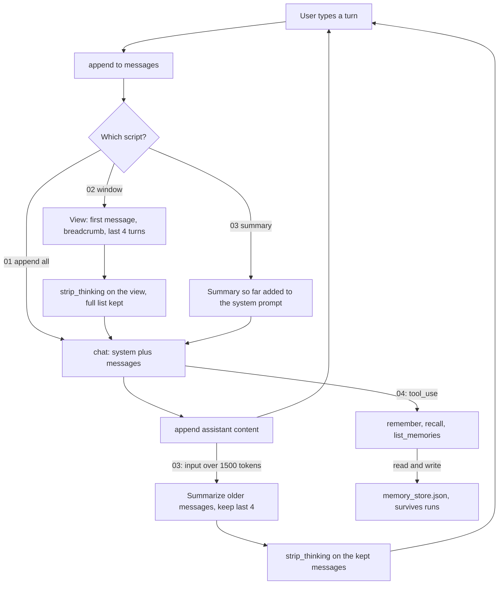

# Lesson 04: Memory and State

"Memory" is the most overloaded word in agent engineering. People mean four different things by it:

| Kind | What it is | Where it lives | Example |
|---|---|---|---|
| **Conversation** | History of the current session | `messages` list | "Earlier you said X..." |
| **Scratchpad** | Working memory within one agent run | `messages` (tool results) | A planner's intermediate notes |
| **Summary** | Compressed conversation history | A summary string in the system prompt | "User is a senior dev; debugging Postgres" |
| **Persistent** | Long lived facts across sessions | A KV store, vector DB, or DB | "User's preferred theme is dark" |

Before going further: **the model has no memory.** Every API call is stateless. Anything that "remembers" is your code: appending to a list, writing to a file, or retrieving from a store. This is the same shift you did in Lesson 00 ("the LLM is a pure function"), now applied to state.

## The loop at a glance



Scripts 01 to 03 differ only in what they send, never in what the user typed: the window trims a copy, the summary moves old turns into the system prompt. `strip_thinking` appears exactly where the start of the history changed; the plain append in 01 sends every block back untouched. Script 04 is the odd one out: the model itself decides what to write to a file that outlives the process.

## Conversation memory: the naive version

You're already doing this in every prior lesson. After each turn:

```python
messages.append({"role": "assistant", "content": response.content})
messages.append({"role": "user", "content": new_user_text})
```

That works fine for short conversations. It does not scale:

- **Cost.** Each turn sends the *entire* history. A 50 turn chat pays for the first 49 turns 50 times.
- **Latency.** More tokens = slower response.
- **Context window.** Eventually you run out.

The fix is not "use the biggest context window." It's a deliberate memory strategy.

## Strategy 1: Windowing

Keep only the last N turns. Always preserve the system prompt and the original user task.

```
[system] [task] [old turn] [old turn] ... [new turn]  ← drop the old ones
                              ↑ keep these
```

Trivial to implement. The catch: a fact mentioned 12 turns ago disappears. Good for chat style agents where recent context dominates; bad for long running agents.

## Strategy 2: Summarization

When history exceeds a threshold, replace the oldest half with an LLM generated summary.

```
[system + summary("..first half..")] [recent turn] [recent turn] ...
```

Adds one LLM call per summarization. Costs more per summarization but saves on every subsequent turn. The summarization prompt is itself worth tuning: it's not chat history; it's *what an agent needs to remember*: decisions made, open questions, user preferences, blocked tools.

A subtle failure: summaries lose detail. A user mentioned a critical date 30 turns ago; the summary compressed it to "discussed scheduling." Worth pairing with a separate **structured fact** store for things you can't afford to lose.

### Trimming meets thinking blocks

Windowing and summarization both *change the start* of the history. On current Claude models that matters: each thinking block is bound to the exact history before it (system prompt, tools, every earlier message). Send a kept turn's thinking block after you trimmed or rewrote what came before it, and the API rejects it (a 400 on accounts created since 31 August 2026; older accounts can opt in to the same check). The scripts here call `strip_thinking()` from `src/_llm.py` on the turns they keep, which is the documented way out for client side trimming. A plain append only loop must do the opposite: send every block back unchanged.

The API can also do this work for you: server side compaction and context editing keep the history valid by construction, and the memory tool gives the model a file style memory it manages itself. Lesson 04b covers them.

## Strategy 3: Retrieval from history

Treat past turns as a corpus. RAG over them.

```
[system] [task] [retrieve(query=current_turn, source=past_turns)] [new turn]
```

This is essentially Lesson 03's pattern applied to your own conversation. Useful for very long running agents (hours/days). Overkill for chat.

## Persistent memory: across sessions

When the user comes back tomorrow, the model knows nothing about yesterday: unless *you* gave it the option to remember.

The modern pattern is **agent controlled memory**: the agent has tools to read and write its own memory.

```
remember(key, value)   → write to store
recall(key)            → read from store
list_memories()        → enumerate keys
forget(key)            → delete
```

This is more flexible than auto storing everything ("preference learning"). The agent decides what's worth remembering based on the conversation. Modern long running assistants (ChatGPT Memory, Claude memory MCP) work this way.

The store itself can be anything: a JSON file, SQLite, a vector DB. The choice depends on:

- **Lookup pattern.** Exact key (KV) vs. semantic (vector DB).
- **Volume.** A handful of facts (file) vs. millions of memories (proper DB).
- **Concurrency.** Single user toy (file) vs. multi user service (DB).

For learning, the simplest store that works is a JSON file. Lesson 04 ends with that.

## State ≠ memory

A subtle distinction that matters. **State** is structured, mutable, and agent owned:

- Current ticket id being worked on.
- Step counter for a budget guard.
- Tool result that the next tool depends on.

State should be passed *explicitly* between steps. Memory is observational: things you've learned about the world. Mixing them in the same data structure (everything thrown into `messages`) is a common antipattern that makes debugging brutal.

## Failure modes

- **Unbounded history.** Cost explodes. Build the window/summary in from the start.
- **Summary loses a fact you needed.** Pair with a structured fact store for high value items.
- **State drift.** "Current ticket id" stored in two places that get out of sync. Pick one source of truth.
- **Memory grows forever.** No eviction policy. Persistent store balloons to gigabytes.
- **Memory leak across users.** A multi user system where memories aren't scoped. Awful privacy bug.
- **Stale memory.** "Remember user prefers X": three years later, X is wrong. Add `updated_at` and an age threshold.

## Hands on

### `01_conversation.py`: naive append everything

A simple chat REPL with no memory management. Type a few questions. Watch the input token count grow each turn. This is the baseline.

### `02_windowed.py`: keep the last N turns

Same REPL, but trims history to the last N turns. Compare token counts.

### `03_summarized.py`: summarize the older half

When history exceeds a threshold, fire one extra LLM call to summarize the older half. The summary lives in the system prompt. Costlier per compaction, cheaper per subsequent turn.

### `04_persistent_kv.py`: agent controlled long term memory

The agent has `remember(key, value)` and `recall(key)` tools backed by a JSON file. Tell the agent something about you in one run; in another run, ask it to recall.

## Key takeaways

- The model has no memory. *You* build it.
- Four kinds of memory: conversation, scratchpad, summary, persistent. Don't mix them.
- Windowing and summarization are conversation memory strategies, not magic.
- Persistent memory should be agent controlled: tools, not auto storing everything.
- Memory has a budget too: tokens, storage, freshness. Plan eviction.

## Common misconceptions

- **"The API remembers my last turn."** It doesn't. You're resending history every call.
- **"Just use a bigger context window."** Cost is linear in tokens *per call*; long histories cost more on every turn. Compaction always wins eventually.
- **"Memory is a database problem."** Storage is trivial. **What** to remember and **when** to recall is the real work.

Next: [Lesson 04b: Long running context](../04b_long_running_context/README.md).
