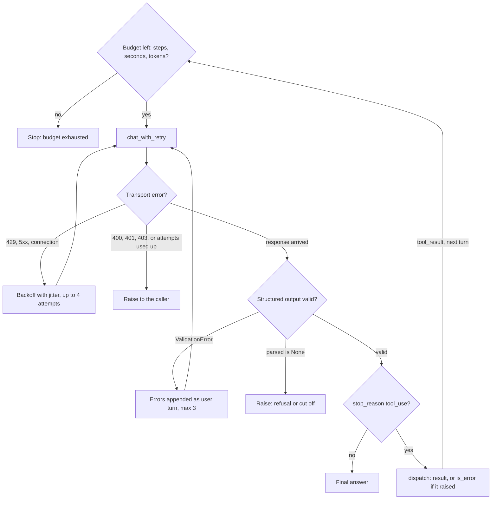

# Lesson 05: Retries and Error Handling

Everything fails. The network drops packets, the model returns garbage, your tool's third party API rate limits you. The lessons up to here mostly assumed the sunny path. Real agents spend a surprising amount of code on the unsunny one.

The trap most newcomers fall into is "wrap everything in try/except, retry 3 times, move on." That's how you send three emails. Retry logic isn't one concept: it's three different concepts depending on *where* the failure happened.

## The loop at a glance

Each script builds one layer (01 transport, 02 model output, 03 tool execution, 04 budget); the diagram stacks them the way one agent step meets them. Only the transport layer repeats the same request. A bad output and a failed tool both go back to the model as messages, so the model decides how to retry, rephrase or fall back, and the budget check before every turn bounds all of it.

## The three failure layers

Every agent step lives at one of three layers. Each has its own retry strategy:

### Layer 1: Transport

The HTTP call to the model API fails. Causes:

- **5xx**: provider had a bad day. Retry.
- **429**: rate limit. Retry with backoff.
- **Timeout / connection reset**: transient network. Retry.
- **401 / 403**: auth issue. **Do not retry.** No amount of waiting fixes a bad key.
- **400**: your request is malformed (wrong message shape, oversized prompt). **Do not retry.** Fix the request.

**Retry strategy:** exponential backoff with jitter. Cap attempts and total wait time. Most SDKs do this for you with sensible defaults: but you should know *what* they're doing, because it's the first thing you'll override.

### Layer 2: Model output

The HTTP call succeeded; the response just isn't usable. Causes:

- **Answer breaks your rules.** Pydantic ValidationError on a pattern, length or range that the schema could only hint at. (Lesson 02 covered this.) With structured outputs and `strict: true` tools, wrong *shapes* are gone; rule violations are what is left.
- **Hallucinated tool name.** Dispatcher can't find it.
- **Hallucinated tool args.** Field that doesn't exist on the schema (impossible with `strict: true`).
- **Cut off answer.** `stop_reason` is `max_tokens`: thinking and output used the whole cap. Raise `max_tokens` or lower the effort; don't retry the same request unchanged.
- **Refusal.** On current models a safety classifier can decline a request: HTTP 200 with `stop_reason: "refusal"` and a `stop_details` category. Always check `stop_reason` before reading content. Some models offer a server side fallback to another model; otherwise treat it as terminal or reformulate once.

**Retry strategy:** don't retry blindly. Feed the *error* back to the model in the next turn: "Your previous response failed validation: ...; try again." The model is good at fixing mistakes it can see. Cap attempts.

### Layer 3: Tool execution

The dispatcher called your function; the function failed. Causes:

- Third party API returned 500.
- Tool's HTTP call timed out.
- Tool's internal state got corrupted.
- The arguments were valid but produced an impossible result ("city not found" for a weather tool).

**Retry strategy:** **don't retry inside the tool**. Return the error to the model as `tool_result` with `is_error=True` and let the model decide:

- Retry with different args ("the city was misspelled, let me try the synonym").
- Switch to a fallback tool.
- Give up and explain to the user.

This is a deep idea. Letting the *model* handle tool level errors gives the agent a chance to recover *intelligently*. Hard coded retries can't.

## Idempotency: the most important word in this lesson

Some tools are safe to retry: `get_weather`, `read_file`. Same call → same result, no side effects.

Some tools are not: `send_email`, `create_user`, `pay_invoice`. Retrying after a flaky response can send two emails.

Before you wrap any tool call in a retry, ask: **what happens if this runs twice?**

- **Safe (idempotent).** Retry freely.
- **Unsafe.** Either make it idempotent (idempotency keys: "if a request with this id has already been seen, return the prior result") or don't retry at all.

The model itself can't reason about this from its training data alone. Encode it in the tool's description: `"This tool sends a real email. It is NOT safe to call twice for the same recipient."`

## Budgets bound everything

Retry without a budget is denial of service against your own bill. Every retry layer needs caps:

- **Max attempts** per layer (transport: 5, model output: 2, tool: 1).
- **Max total wall time** (e.g., 60s for an interactive agent).
- **Max cumulative input tokens** (cost cap).
- **Max total cost** (if you can estimate it).

We built `Budget` in Lesson 00; this lesson wires it into the failure paths.

## Distinguish retryable from terminal

Before retrying, classify the error. Same error code can be retryable in one context, terminal in another.

| Error | Retryable? | Why |
|---|---|---|
| `429 RateLimited` | Yes (backoff) | Transient |
| `502 BadGateway` | Yes (backoff) | Provider hiccup |
| `400 BadRequest` | **No** | Your request is broken; same retry will fail |
| `401 Unauthorized` | **No** | Bad credentials |
| `stop_reason: "refusal"` | **Maybe once** | If you can reformulate; otherwise give up |
| `stop_reason: "max_tokens"` | Yes, changed | Raise `max_tokens` or lower effort first |
| `ValidationError` (pydantic) | Yes with feedback | Model can self correct |
| `ToolReturnedError` | Let the model decide | Don't auto retry inside the dispatcher |

## Failure modes (yes, retry logic has failure modes too)

- **Retry storm.** Upstream is down; everyone's clients retry; you DDoS your own provider. Jitter helps; backoff helps; circuit breakers help.
- **Silent fallback.** A retry with fallback path hides the underlying bug for weeks. Always log it, even if you recover.
- **Nonidempotent retries.** Two emails, two charges, two user accounts.
- **Infinite repair loop.** Model keeps producing wrong schemas; you keep reprompting; budget never trips. Cap attempts hard.
- **Retry on auth error.** Burning your rate limit to fix nothing.

## Hands on

### `01_transport_retry.py`

Wrap the `chat()` call in an exponential backoff helper. Show the SDK's built in retry config and when to override it. Demonstrate jitter.

### `02_schema_retry.py`

A structured extraction helper that asks for structured output, validates it with the full Pydantic model, and reprompts the model with the validation error. The "feed the error back" pattern (a small generalization of Lesson 02's repair loop).

### `03_tool_error_loop.py`

A `flaky_search` tool that fails 50% of the time. Watch the agent reason its way out: retry the tool, then fall back to a different approach when retries don't help.

### `04_budget_guard.py`

The Budget class from Lesson 00, wired into the loop with proper exhaustion handling. Run the agent under a tight budget and watch it terminate cleanly.

## Key takeaways

- Three retry layers: transport, model output, tool execution. Each has its own strategy.
- Idempotency is the question to ask before any retry.
- Let the model handle tool level errors when possible. It's smarter than your dispatcher.
- Every retry needs a budget cap. Without one, you've built a money pump.
- Some errors are terminal. Classify before retrying.

## Common misconceptions

- **"Retry 3 times and move on."** Works for `get_weather`, ruins `send_email`.
- **"The SDK handles retries."** It handles *transport* retries. Model output and tool execution retries are your job.
- **"More retries = more reliability."** Past 3 to 5 attempts, you're just amplifying problems.

Next: [Lesson 06: Human in the loop](../06_human_in_loop/README.md).
