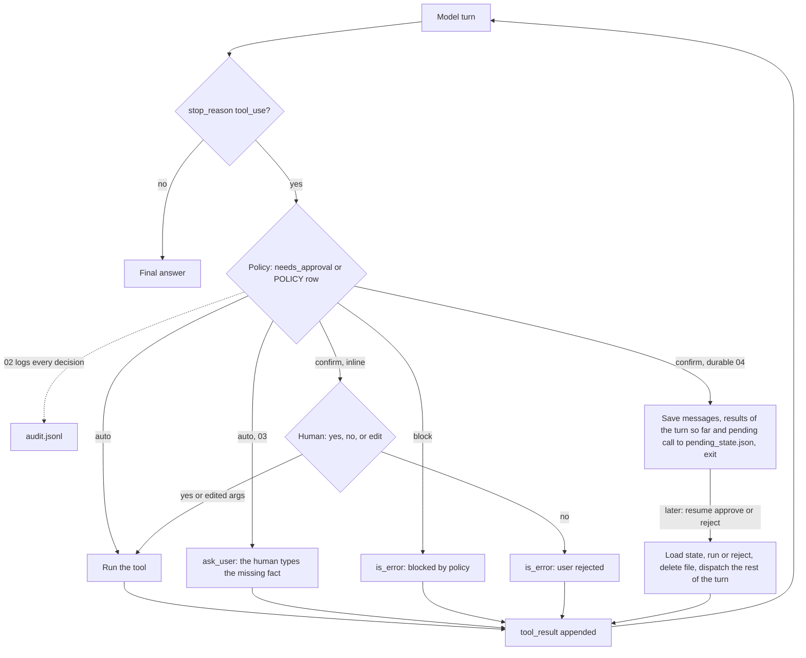

# Lesson 06: Human in the Loop

Some tool calls are too consequential to execute automatically. Sending email to a customer. Pushing code. Refunding money. Posting publicly. If the agent gets it wrong, "we'll iterate next sprint" is not a recovery plan.

Human in the loop (HITL) is the umbrella term for "the agent pauses, asks a human, and continues based on the response." The pattern shows up at three levels of escalating complexity:

| Level | Pattern | Where it's used |
|---|---|---|
| 1. **Inline approval** | The loop pauses on each risky tool call: `y/n/edit?` | CLI agents, dev tools |
| 2. **Policy based** | A registry maps each tool to a policy: `auto`, `confirm`, `block` | Most production agents |
| 3. **Durable pause** | Serialize state; human responds minutes/hours later; resume | Async workflows, multi day approvals |

This lesson builds all three. There's also a distinct primitive (**asking the user for information**) that's often conflated with approval and shouldn't be.

## The loop at a glance



Every path ends in a `tool_result`, so a rejection or a block is just another message the model must handle. `ask_user` is an ordinary tool whose body happens to wait for a person; the approval gate sits in the dispatcher, before the tool body runs. The durable path is the inline gate with the wait moved to disk: `04_durable_pause.py` exits and a later `--resume` finishes the turn. A turn can hold several `tool_use` blocks and the pause can come on any of them, so the saved state keeps the results the turn already produced; resume adds the decision, dispatches the calls after the pending one (which may pause again) and then sends one user message with a `tool_result` for every `tool_use` of the turn, as the API requires.

## Approval vs. asking: two different things

- **Approval**: the agent has decided to do X. It needs permission. Yes/no/modify.
- **Asking**: the agent is missing information. It needs an answer. "What's your account number?"

Both pause the loop. Both involve the user. They use different tools, have different return types, and surface different UI in production. Conflating them in code makes the agent harder to reason about. We define both, separately, in this lesson.

## The CLI is a baby version of production HITL

A `input()` call works for a learner running a script. In production:

- The user isn't sitting at a terminal.
- The approval might take minutes, hours, or days.
- The agent process may have died and restarted in between.
- Multiple approvers might be involved (manager → finance → security).

The solution is the **durable pause**: serialize the agent's full state (messages, pending tool_use, metadata) to a store. The agent process exits. When the human approves (via Slack, email, web UI), a worker resumes the agent from the persisted state.

You'll build a toy version of this in `04_durable_pause.py`. The persisted state is a JSON file; "resume" is running the script again with a `--resume` flag. The shape is the same as production systems that use Postgres or Redis instead.

## Policy tables: the right shape for production

Hard coding `if tool.name == "send_email": ask_approval()` doesn't scale past three tools. Instead:

```python
POLICY = {
    "send_email":    "confirm",
    "get_weather":   "auto",
    "delete_file":   "block",
    "read_file":     "auto",
    "transfer_funds": "confirm",
}
```

Two benefits:

1. Adding a tool means adding a row. No code changes elsewhere.
2. The policy is visible: easy to audit ("which tools auto run?").

Production systems extend this with **risk tiers** (low/medium/high) and **conditions** (e.g., "auto confirm if amount < $100"). The shape is the same.

## The edit path is the underrated one

Production agents that *only* let users approve or reject end up rubber stamped. The user always approves; the system becomes theater. Adding an **edit** path ("approve as is, or modify the arguments and approve modified") is where HITL earns its keep.

The flow:

```
agent proposes: send_email(to="ceo@acme.com", subject="Q3 budget", body="...")
user: edit
agent: shows args; user edits subject to "Q3 budget: DRAFT" and rejects body
agent: re-prompts with edited args; sends.
```

Implementation wise, the edit just becomes: agent emits the tool_use, the harness intercepts and lets the user mutate the args, then the harness either dispatches the (mutated) call or feeds an `is_error=True` tool_result back to the model so it can replan.

## Audit trail: the unsexy must have

Every approval decision must log:

- **Who** decided (user id).
- **When** (timestamp).
- **What** was approved or rejected (full tool_use args, not a summary).
- **Why** (optional, but encouraged).

This is nonnegotiable for any agent touching real world state. The audit trail is what saves you when an approved action turns out to be wrong: "the user explicitly approved sending this email at 14:32, here's the record." We'll log to JSONL in the hands on: same idea as Lesson 07's tracer.

## Failure modes

- **User approves a stale proposal.** Between proposal and approval, the agent's plan changed. The approved args no longer match what the agent would now do. Mitigation: tie approval to a *specific* proposal id; reject stale approvals.
- **Args mutated between proposal and execution.** Race condition. Use immutable proposal records.
- **Loop blocks forever.** Human approval never comes. Add a timeout / escalation.
- **Approval fatigue.** Users rubber stamp. Risk tier; auto confirm low stakes.
- **No correction path.** Binary approve/reject without edit. Forces the user to reject and reprompt, which is worse UX than just letting them edit.
- **No audit trail.** Approval happened, no record. You can't reconstruct decisions later.

## Hands on

### `01_approve_cli.py`

The simplest version: a `require_approval` decorator on the dispatcher. Before executing certain tools, print the args and ask `y/n/edit/reason`. CLI only; sufficient for learning.

### `02_policy_table.py`

Replace ad hoc `if tool == "x"` with a policy table. Each tool's risk level lives next to its registration. Auto confirm low risk, prompt for medium, block high.

### `03_ask_user_tool.py`

A separate `ask_user(question)` tool for *information*, distinct from approval. The agent calls it when it's missing context. Watch the loop pause for input, then continue with the answer in scope.

### `04_durable_pause.py`

The agent serializes itself to JSON, exits, and is resumed via `--resume`. A toy version of production async HITL, where the human might respond hours later. Ask it to email two people at once to see a turn with two calls that each pause: the second pause comes during the first resume, and the second resume sends both results in one message.

## Key takeaways

- HITL has three levels: inline, policy based, durable. Each is one step toward production.
- Approval and asking for info are different primitives. Don't conflate them.
- Risk tier tools to avoid approval fatigue.
- Always provide an edit path, not just approve/reject.
- Log every approval decision. No exceptions.
- Production HITL is fundamentally durable: design state to survive a process restart.

## Common misconceptions

- **"HITL = `input()` prompt."** That's the toy version.
- **"Just confirm everything."** Users will rubber stamp. The system becomes theater.
- **"The model can ask the user."** Yes: but that's a *question* tool, distinct from an *approval* gate. Both are useful; they're not the same thing.

Next: [Lesson 07: Evaluation and tracing](../07_eval_tracing/README.md).
