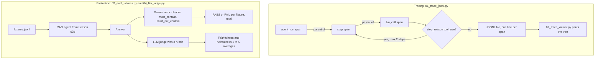

# Lesson 07: Evaluation and Tracing

Two distinct problems get conflated all the time:

- **Tracing**: *what happened*? Reconstruct what the agent did, what it called, with what arguments, in what order, how long things took.
- **Evaluation**: *was it good*? Grade the agent's outputs against ground truth or rubrics.

Tracing is observability. Evaluation is quality measurement. You need both, and you build them differently.

This lesson covers:

1. A tracer that writes JSONL spans, one per agent step / LLM call / tool call.
2. A tiny viewer that pretty prints the trace tree.
3. An eval harness: a fixture file, deterministic checks, pass/fail aggregation.
4. LLM as judge: rubric based scoring for things deterministic checks can't measure.

## The loop at a glance



In the tracing box every `with tracer.span(...)` opens a child of the span around it and writes one JSONL line when it closes; the demo calls no tools, so it has no `tool_call` span, which would nest under its step the same way. In the evaluation box the same fixtures run through the Lesson 03b agent, then through the deterministic checks of `03` and the rubric judge of `04`.

## Tracing: what's a "span"?

Borrow OpenTelemetry's vocabulary. A trace is a tree of spans. Each span has:

- A **kind** (`agent_run`, `llm_call`, `tool_call`, `retrieval`, `eval`, ...)
- A **parent** (the span that started this one)
- **Inputs**, **outputs**, **timestamps**, **metadata** (tokens, cost, model id)
- A **status** (`ok`, `error`)

A typical agent run looks like:

```
agent_run "answer the user's question"
├── llm_call (turn 1)
│   └── tool_call search_docs(query="vacation policy", k=3)
│       └── retrieval (3 hits)
├── llm_call (turn 2)
│   └── tool_call search_docs(query="rollover")
└── llm_call (turn 3) → final answer
```

JSONL ("JSON lines") is the right starting format: one span per line, append only, grep able. Production teams ship spans to systems like Langfuse, Phoenix, or Braintrust: they're all storing essentially the same tree. Build it locally first; you'll know what those tools are doing.

### Why "one span per line, append only"?

- Append only writes survive crashes; the file is valid up to the last newline.
- One JSON per line means `head`, `tail`, `grep`, `jq` all just work.
- You can stream traces while the agent runs, not only after it finishes.

## Evaluation: the test suite for nondeterminism

Eval comes in a few flavors. You'll want all of them eventually:

| Flavor | What it measures | Example |
|---|---|---|
| **Deterministic** | Exact / regex / contains / schema match | "Answer contains '18 days'" |
| **Semantic** | Meaning level correctness | "Did the answer faithfully reflect the cited chunk?" |
| **Per step** | Each agent step | "Did it call `search_docs` before answering?" |
| **End to end** | Final output only | "Was the answer correct?" |
| **Human** | Eyeball | Spot check edge cases |

For most agents, the right starting point is a small set of **fixture cases** (10 to 30), each with deterministic checks, run on every change. Add LLM as judge for cases where deterministic checks aren't expressive enough.

### Fixture shape

A fixture is just a struct:

```json
{
  "id": "vacation-001",
  "input": "How many vacation days do I get?",
  "must_contain": ["18 days"],
  "must_not_contain": ["unlimited"],
  "must_cite": ["vacation_policy.md#0"]
}
```

When you change the agent, you run the fixtures and check pass rates. A test suite for vibes.

## LLM as judge: the powerful, biased tool

Sometimes deterministic checks aren't enough. "Is this answer faithful to the cited chunk?" is hard to regex; easy to ask another LLM to score.

**Well known biases of LLM judges:**

- **Position bias**: judges tend to favor whichever response was listed first when comparing.
- **Verbosity bias**: longer answers get higher scores even when shorter ones are correct.
- **Self preference**: a judge model often rates outputs from its own model family higher.

**Mitigations:**

- **Rubric prompts**: give the judge a fixed 0 to 5 scale with explicit criteria.
- **Pair and swap**: judge each pair twice with positions swapped.
- **Different model family**: judge with a different vendor's model when possible.

LLM as judge gives you a directional quality signal, not ground truth. Treat it as opinion at scale.

## What to actually log (and what not to)

| Log this | Don't log this |
|---|---|
| Tool inputs (sanitize PII) | Raw user PII |
| Token counts and timing | Full embedding vectors |
| Final answer | Every prompt cached prefix verbatim |
| Span errors with stack traces | Stack traces with secrets in env vars |
| Model id and parameters | API keys, headers |

In production, tracing has a cost: bytes shipped, indexing, storage. Sample low value traffic; trace 100% of errors.

Once you have the shape, you rarely hand roll the shipping. The Anthropic SDKs emit OpenTelemetry spans for API calls, so the same tree can go to any OpenTelemetry backend (Phoenix, Langfuse, Honeycomb, Jaeger) next to your own spans. The JSONL tracer here is the same idea with no backend to run.

## Hands on

### `01_trace_jsonl.py`

A `Tracer` context manager with `span()` for nested spans. Writes JSONL to `traces/agent_run_<ts>.jsonl`. We run the RAG agent from Lesson 03b under the tracer and watch the file fill up.

### `02_trace_viewer.py`

Reads the JSONL, builds the tree, pretty prints it with timing and a one line summary per span. Same tree, prettier.

### `03_eval_fixtures.py`

A `fixtures.jsonl` file with 6 cases over the Acme corpus. The harness runs the agent on each input and applies deterministic checks (`must_contain`, `must_not_contain`, `match_any_of_contain`). Reports pass/fail and a summary.

### `04_llm_judge.py`

A rubric judge that scores answers 1 to 5 on **faithfulness** (does the answer reflect the cited chunks?) and **helpfulness** (does it actually answer the question?). Same fixtures from `03_`, now with semantic scoring layered on top. The judge runs on a stronger model than the agent (`claude-sonnet-5-5` judging the default Haiku) and returns its scores as a structured output, so the rubric comes back typed.

## Key takeaways

- Tracing answers "what happened?"; evaluation answers "was it good?" Don't conflate.
- A trace is a tree of spans. JSONL is the right local format.
- An eval set is frozen ground truth. Version it; treat it like tests.
- Deterministic checks first; LLM as judge for what they can't measure.
- LLM judges have known biases. Use rubrics, mitigate position bias, document the judge model.

## Common misconceptions

- **"Logs are a trace."** Logs are flat; traces are structured trees. Different debugging power.
- **"LLM as judge is objective."** It's an opinion at scale, with biases. Useful directionally.
- **"I'll add evals later."** You won't. Five fixtures now beats fifty fixtures never.
- **"My traces should be human readable text."** Structured (JSONL) first; pretty viewer later. Bytes are cheap; debugging is expensive.

Next: [Lesson 08: Guardrails](../08_guardrails/README.md).
