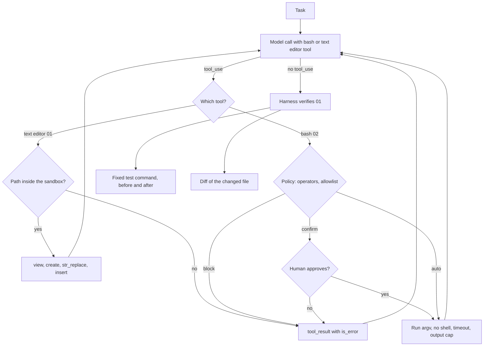

# Lesson 08b: Coding Agents

The most common agent in use today does not answer questions. It reads files, changes them, and runs commands: a coding agent. Claude Code, IDE assistants and CI bots that open pull requests are all this shape.

Nothing new is needed to build one. It is the Lesson 00 loop with two tools that touch the real machine. What changes is the stakes: a wrong answer is text you can ignore, a wrong command deletes your work. So this lesson is mostly about the harness around the loop: where the agent may work, what it may run, who approves, and how you check the result.

## The loop at a glance



The model only proposes; every arrow out of "Which tool?" passes a check the harness owns before anything touches the sandbox, and every refusal goes back to the model as an error it can read. Script `01` uses only the text editor and ends with the test and diff check, script `02` uses only bash behind the `auto`, `confirm`, `block` table.

## The two Anthropic defined tools

Lesson 01 tools are yours: you write the name, description and JSON schema. The bash tool and the text editor tool are different. Anthropic defines them, the model is trained on them, and you declare them by `type` and `name` only:

```python
BASH = {"type": "bash_20250124", "name": "bash"}
TEXT_EDITOR = {"type": "text_editor_20250728", "name": "str_replace_based_edit_tool"}
```

No `input_schema`. Passing one, or defining your own tool that happens to be called `bash`, gives you an ordinary custom tool without the trained behavior.

Both are **client tools**: the API only returns a `tool_use` block. Your code runs the command or edits the file and sends back a `tool_result`. Anthropic hosts no sandbox for them; the sandbox is yours to build.

| Tool | Input the model sends | What your handler does |
|---|---|---|
| `bash` | `{"command": "..."}` or `{"restart": true}` | Run the command (or reset the shell), return stdout and stderr |
| text editor | `command` = `view`, `create`, `str_replace` or `insert`, plus `path` and the fields for that command | Show a file or folder, create a file, replace exactly one match, insert after a line |

The text editor's `str_replace` must fail when `old_str` matches zero times or more than once. That rule is what makes edits precise: the model has to quote enough context to point at one place. On any failure return a `tool_result` with `is_error: true` and a clear message, so the model can read the file again and retry.

The optional `max_characters` field on the text editor declaration caps how much one `view` returns.

## The loop is the same loop

```
messages = [task]
loop:
    response = chat(messages, tools=[BASH, TEXT_EDITOR])
    append response
    if no tool_use: done
    for each tool_use: check it, run it in the sandbox, collect tool_result
    append tool_results
```

Compare it with `lessons/00_mental_model/02_loop_with_budget.py`. The only new code is inside "check it, run it".

## Sandboxing: where the agent may act

Treat every command and every path as untrusted input. The model may be wrong, and (Lesson 08) it may be steered by text it read in a file.

- **A working folder.** The agent works in one folder and nowhere else. The scripts here create `sandbox/` next to themselves on each run.
- **Path checks.** Resolve every path to its canonical form and check it is still inside the folder (`Path.resolve()` then `is_relative_to(root)`). That one check catches `..`, absolute paths and symlinks. Reject encoded forms such as `%2e%2e` instead of decoding them.
- **An allowlist of programs.** Name the programs the agent may run. A deny list (`rm`, `curl`, ...) always misses one. Reject shell operators (`;`, `&&`, `|`, `>`, backticks, `$(`) so one allowed program cannot chain into another, and run the program without a shell (`subprocess.run(argv, shell=False)`).
- **Timeouts and output caps.** A command that hangs stalls the loop; a command that prints a megabyte fills the context. Cap both.
- **No network unless the task needs it.**
- **Containers in real deployments.** A Python harness can only filter. Real isolation is a container or virtual machine with a read only base image, the project mounted, no credentials inside, and network off by default. An allowed `python` can still read any file the process can read; only the operating system can stop that.

## Permissions and approval

Lesson 06's policy table carries over directly. Rank actions by how hard they are to undo:

| Action | Policy |
|---|---|
| List, read, search files | `auto` |
| Edit files inside the working folder | `auto` or `confirm`, depending on how much you trust the task |
| Run programs (tests, scripts, builds) | `confirm`, or `auto` for one fixed test command |
| Delete, push, install, reach the network | `block`, or `confirm` with a human who reads the command |

The bash tool gives the harness only an opaque string. That is why production agents promote risky actions to dedicated tools: a `run_tests` tool with no arguments is easy to auto approve, a `git_push(branch)` tool is easy to gate and audit. Start with bash for breadth, promote an action to its own tool when you need to gate, audit or render it.

## Verification: the harness checks, not the model

A coding agent saying "fixed" is a claim. Two cheap checks turn it into evidence:

1. **Run the tests** with a fixed command the harness chooses, not one the model writes. The exit code is the verdict.
2. **Read the diff.** Compare the files before and after the run (`difflib`, or `git diff` in a real repository). A passing test with a diff that also rewrote the test file is not a fix.

In production, feed a failing test result back as the next user message and let the loop continue, with a step budget. Show the final diff to a human before anything leaves the sandbox: a commit, a push, a deploy.

## Context discipline

Files are large and the context window is shared with everything else (Lesson 00b).

- **Search before reading.** List the folder, grep for the name, then open the one file that matters.
- **Read in parts.** `view` with `view_range` returns only the lines asked for; cap `view` output with `max_characters`.
- **Keep tool output short.** Truncate long command output and say that you did.
- **Small edits.** `str_replace` of three lines costs far less than recreating a whole file, and the diff stays readable.

## Failure modes

- **Path escape.** A handler that opens the raw `path` string. One `../../.env` and secrets are in the context.
- **Shell chaining.** An allowlist that checks only the first word of `ls; rm -rf ~`.
- **Edits to the tests.** The agent makes the test pass by weakening the test. Read the diff; protect test files if needed.
- **Runaway loops.** No step budget, no timeout. The agent retries the same failing command forever.
- **Approval fatigue.** Every `ls` needs a click, so people click yes to everything. Auto approve the read only actions.
- **Stale reads.** The agent edits a file from an old view after something else changed it. Dedicated edit tools can reject writes when the file changed since the last read.

## Hands on

### `01_text_editor_agent.py`

Creates `sandbox/` with a buggy `stats.py` and its test. The agent gets only the text editor tool and a virtual root, `/project`, that the handler maps onto the sandbox. Watch the path self check reject traversal, absolute and encoded paths, then watch the agent list, view and patch with `str_replace`. The harness runs the test with a fixed command before and after, and prints the diff for you to review.

### `02_bash_with_policy.py`

The bash tool behind a policy table: `ls` and `cat` run automatically (implemented in Python, so the script works on Windows and POSIX), `python` asks for approval, everything else is blocked, and shell operators are rejected before anything runs. The self check shows `curl`, `rm` and a piped command being blocked without any API call. Answer `n` at the prompt once to see the model react to a declined command.

## Key takeaways

- A coding agent is the ordinary agent loop with file and shell tools; the engineering is in the harness.
- The bash and text editor tools are declared by `type` and `name` only, and executed by your code.
- Confine every path to a working folder, allowlist programs, reject shell operators, cap time and output.
- Reuse the policy table: read freely, ask before writes and commands, block what cannot be undone.
- Verify with a fixed test command and a diff, never with the agent's own summary.
- Search first, read in parts, edit small.

## Common misconceptions

- **"The model would never run something destructive."** It runs what its context suggests. A README in the repository can contain instructions too.
- **"A deny list of dangerous commands is enough."** There is always another program, flag or quoting trick. Allow what is needed, block the rest.
- **"Running it in a subfolder is a sandbox."** A folder limits what your handler opens. Only a container or virtual machine limits what a program can do.
- **"Tests pass, so the change is right."** Tests pass, so the change did not break what the tests check. Read the diff.

Next: [Lesson 09: MCP and tool servers](../09_mcp/README.md).
