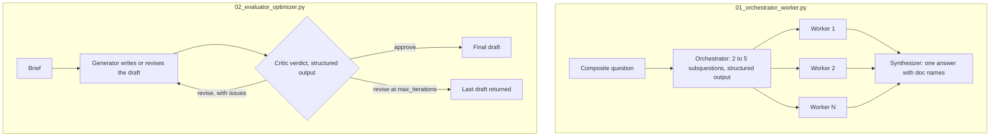

# Lesson 09b: Multi Agent Orchestration

Up to this point every lesson has used **one** agent. Real production systems often use several, each scoped to a specific job. This lesson covers the small set of orchestration patterns that the field has converged on, plus the failure modes that come with multi agent code.

The pattern vocabulary comes primarily from Anthropic's [Building Effective Agents](https://www.anthropic.com/research/building-effective-agents) (2024, expanded 2025 to 2026). It's the closest thing to canonical taxonomy.

## The loop at a glance



On the left the workers run in a thread pool, each with its own context: the handbook in its system prompt and one subquestion, never the other workers' output. On the right the critic has a different system prompt and a rubric, and its issues travel back to the generator as feedback until it approves or the iteration cap ends the loop.

## When to reach for more than one agent

The first question is *should you*. Multi agent systems are seductive and overused. The right time:

- The task has **independent subquestions** that can run in parallel.
- The task needs **specialized expertise** that benefits from a focused system prompt + scoped tools.
- You want **isolation**: separate context windows, separate audit trails, separate failure domains.
- You need **adversarial evaluation**: a critic that the producer can't game.

The wrong time:

- A single agent with a good system prompt handles it. Don't add agents to feel more "agentic."
- The subtasks are sequential and dependent. Just write a loop.
- The cost quality tradeoff doesn't pencil out: every extra agent is another LLM call.

## The five patterns

### 1. Prompt chaining

```
A -> B -> C
```

Output of one call is input to the next. Each step is specialized. Simple, deterministic, easy to reason about. Use when the steps are inherently sequential (extract → translate → summarize) and each step is small enough to do well in isolation.

### 2. Routing

```
       /-> spec-A
classifier
       \-> spec-B
```

A small first pass agent classifies the input, then dispatches to a specialist. Common for support bots: triage agent decides "billing" vs. "technical" vs. "account" and routes. The classifier can be a tiny model; the specialist is wherever the heavy lifting lives.

### 3. Parallelization (sectioning and voting)

```
sectioning:  task -> [worker-A, worker-B, worker-C] -> synthesizer
voting:      task -> [worker-A, worker-A, worker-A] -> majority vote
```

Two flavors. **Sectioning** splits a task into independent parts (research three subtopics in parallel, then merge). **Voting** runs the same task multiple times and aggregates for reliability (used for safety critical classification).

### 4. Orchestrator workers

```
                          /-> worker
orchestrator -- decomposes --> worker
                          \-> worker
       \________________________/
                  |
            synthesis
```

The decomposition isn't known up front. An **orchestrator** agent reads the request, decides at runtime how many workers to spawn and what each should do, dispatches, and synthesizes results. The pattern behind Claude Code's `/batch`, Devin's planning loop, and Anthropic's multi agent research demos.

The orchestrator is *always* an LLM (decomposition needs judgment). Workers can be LLMs *or* deterministic functions.

### 5. Evaluator optimizer

```
prompt -> generator -> draft
              ^         |
              |         v
              critic <-- scoring
```

Generator writes a draft, critic scores it against a rubric, generator revises based on the critic's notes, loop until the critic approves or you hit a max iterations budget. The classic refinement pattern: useful when a single shot underperforms but the model can self correct given good feedback.

The critic *must* be a different prompt (and ideally a different agent role) from the generator, or it'll just rubber stamp. Some teams use a different model family for the critic to reduce self preference bias (see Lesson 07's LLM as judge discussion).

## Subagents: the implementation primitive

Anthropic added **subagents** to Claude Code as a first class concept in 2025, and the pattern has spread. A subagent is:

- A scoped LLM call (its own system prompt, its own tool set, its own permissions).
- With its own context window: the parent never sees the subagent's full transcript, only its summary or its return value.
- Useful for delegating a focused task without polluting the parent's context.

In code terms, a subagent is just a function: `subagent(task, tools, system_prompt) -> result`. The parent calls it, gets back a clean answer, doesn't carry the working memory. This is what makes orchestrator workers tractable: without context isolation, the parent's context window would blow up after a few workers.

**When *not* to use subagents** (per Claude Code's docs):

- Sequential dependent steps: the overhead of context isolation outweighs the benefit.
- Same file edits: coordination cost.
- Trivial tasks: a single agent does it faster.

## Where these compose

Real systems combine patterns. A typical research agent:

1. **Routing**: classify the request as "factual lookup" vs. "open research" vs. "comparison."
2. **Orchestrator workers**: for open research, decompose into subquestions, dispatch workers in **parallel**.
3. **Evaluator optimizer**: for the final report, have a critic check citations and tone before returning to the user.

That's three patterns in one workflow. The art is knowing which to reach for at each step.

## Failure modes

- **Supervisor bottleneck.** Orchestrator becomes a single point of failure and a latency choke. Watch its step count and tool budget.
- **Worker context bloat.** Workers accumulate state from the orchestrator's preamble. Keep the worker's system prompt focused; pass only what it needs.
- **Critic rubber stamping.** Evaluator says "looks good" every time. Mitigation: structured critic output (must list specific issues), or a different model family.
- **Infinite refinement.** Generator critic loops with no progress. Cap iterations and require the critic to declare "no further improvement possible."
- **Cost surprise.** Three workers in parallel are three LLM calls. Multiply by your concurrency. Budget per orchestration, not per call.
- **Hidden coupling via shared memory.** Two workers writing to the same persistent memory race or overwrite. If you share state, use Lesson 04's persistent memory carefully.

## When to use A2A vs. in process orchestration

Lesson 09 introduced A2A as the cross vendor protocol for agent delegation. For multi agent systems **inside one codebase**, you don't need A2A: a Python function call is the orchestrator worker dispatch. Reach for A2A when:

- Workers belong to different teams (separate deploy lifecycles).
- Workers are in different languages.
- You need observable streaming progress across an organizational boundary.

For everything else, in process subagents (this lesson) are cheaper and faster to iterate on.

## Hands on

### `01_orchestrator_worker.py`

A research question is split by an orchestrator LLM call into N subquestions; each subquestion is dispatched to a worker (running in parallel via a thread pool); the orchestrator synthesizes the results into one answer. The trace shows the decomposition, the parallel fan out, and the synthesis.

### `02_evaluator_optimizer.py`

A generator drafts an internal announcement. A critic, with a different system prompt and a structured rubric, scores it and lists specific issues. The generator revises. Loop until the critic approves or we hit a max iterations cap. The trace shows the convergence (or nonconvergence) of the critic and revise pattern.

## Key takeaways

- Multi agent isn't automatically better. Use it when subtasks are independent, expertise must be scoped, or you want adversarial evaluation.
- Five patterns cover most cases: chaining, routing, parallelization, orchestrator workers, evaluator optimizer. They compose.
- A subagent is a scoped LLM call with its own context window. It's the implementation primitive behind orchestrator workers.
- The critic must be structurally different from the generator, or you get rubber stamps.
- Cost scales with concurrency. Budget per orchestration.

## Common misconceptions

- **"More agents = smarter system."** Often the opposite. Each agent adds coordination cost and failure modes.
- **"A2A is the protocol for in process multi agent."** No: A2A is for cross process/cross vendor. In process is just function calls.
- **"The orchestrator must be the strongest model."** Usually true for decomposition, but workers can be smaller cheaper models if the subtasks are constrained.

Next: [Lesson 09c: Many tools](../09c_many_tools/README.md), then [Lesson 09d: Multi agent systems](../09d_multi_agent_systems/README.md), which takes these patterns further: handoffs, parallel agents on a shared state, compliance gates, and tracing and budgets across agents.
