# Lesson 09d: Multi Agent Systems

[Lesson 09b](../09b_multi_agent/README.md) named the patterns: orchestrator workers, evaluator optimizer, routing. This lesson builds the machinery that turns those patterns into a system you can leave running: how control and context move between agents (sub agents and handoffs), how agents share state without stepping on each other (a typed blackboard), how a reviewer keeps a worker inside hard rules (compliance gates that fail closed), and how you see and stop what a group of agents is doing (distributed traces, circuit breakers, routing by agent cards). Every mechanism is plain Python around `chat()`, small enough to read in one sitting, and every script runs offline with `--dry-run`.

## The loop at a glance

```mermaid
flowchart TD
    subgraph S1["01 sub agents and handoffs"]
        P["Parent agent"] -->|"research_agent"| SA["Sub agent loop, fresh context"]
        SA -->|"final answer only"| P
        T["triage"] -->|"note"| B["billing"]
        B -->|"note"| H["hr"]
    end
    subgraph S2["02 fan out and blackboard"]
        SP["it, policy, expenses in parallel"] -->|"guarded writes"| BB["SharedState board"]
        BB --> WR["Writer reads the full board"]
    end
    subgraph S3["03 generator critic"]
        W["Worker draft"] --> G{"Code gates"}
        G -->|"issues"| W
        G -->|"pass"| RU{"Model rubric"}
        RU -->|"issues"| W
        RU -->|"approve"| PUB["Publish"]
    end
    subgraph S4["04 tracing and budgets"]
        RC["Router over agent cards"] --> AG["Agents share one budget"]
        AG -->|"breaker trips"| STOP["Fail closed"]
    end
```



In 01 the parent keeps the conversation and gets back one answer; in a handoff the conversation moves on and only a note goes with it. In 02 the specialists never talk to each other: they read and write one board, and the board decides which writes stand. In 03 the code gates run before any model judges the draft, and the loop only ends with a draft that passed them or with nothing. In 04 every arrow carries a trace id and spends from one budget.

## Two ways to move control: sub agent or handoff

Both patterns let one agent use another. They differ in who owns the conversation afterwards.

**A sub agent is a tool.** The parent calls `research_agent(task)`. The implementation of that tool is a whole agent loop: its own system prompt, its own tools, a fresh `messages` list that starts with the task and nothing else. It may search five times and read ten paragraphs; the parent sees none of it. The tool result is the sub agent's final answer. Control comes back to the parent, which still holds the conversation with the employee.

```python
def research_agent(task: str) -> str:
    answer, transcript = run_loop("research", RESEARCH_SYSTEM, [SEARCH_TOOL], task, dispatch)
    return answer  # the transcript stays here
```

That is the same `run_loop` the parent runs. A sub agent is not a new kind of thing; it is the Lesson 01 loop called from inside a tool.

**A handoff gives the conversation away.** The agents are states of a small state machine. Each turn the active agent returns a `Turn` (structured output): either an answer, or a handoff to another agent with a short note. The router moves control:

```python
for hop in range(1, max_hops + 1):
    response = chat([{"role": "user", "content": request + note}], system=AGENTS[active], output_schema=Turn)
    turn = response.parsed
    if turn.action == "answer":
        return turn.answer
    active, note = turn.handoff_to, turn.note
```

That loop, plus a check that the target exists, is the whole mechanism. Frameworks add persistence, streaming and a nicer syntax, but the core is this.

| | Sub agent as a tool | Handoff |
|---|---|---|
| Who answers the user | The parent | Whoever holds control last |
| What crosses over | The task in, the final answer out | The request and a note |
| Context of the caller | Grows by one tool result per call | Not involved any more |
| Good for | Research, reading, any work whose detail the caller does not need | Routing a conversation to the specialist who owns the topic |

### Context is what you pass, not what exists

The point of both patterns is the same: each model call is sent only what that agent needs. In `01_subagents_and_handoffs.py` the parent's requests stay small while the sub agent's grow with every search result, and the sub agent's whole transcript is thrown away when it returns. In the handoff run each hop is sent the request plus one note; the script prints next to it how much a router that forwards the whole history would resend. That number grows with every hop, and so do cost, latency and the chance that an agent acts on an earlier agent's half finished reasoning.

The price of passing less is that something can be lost. A handoff note is a summary written by a model. If the next agent needs a fact the note left out, it has to ask again. Write the note field's description carefully ("what the next agent needs"), and keep the original request in every hop, as the router here does.

## Fan out over a shared board

Lesson 09b's orchestrator gave each worker a subquestion and collected strings. That works while the results are independent prose. When agents produce parts of one structured result, give them a **blackboard**: one typed object they all read and each writes a part of.

```python
class SharedState(BaseModel):
    request: str
    equipment: list[str] = Field(default_factory=list)       # it
    security_steps: list[str] = Field(default_factory=list)  # it
    remote_rules: list[str] = Field(default_factory=list)    # policy
    expense_rules: list[str] = Field(default_factory=list)   # expenses
    plan: str = ""                                            # writer
```

Three rules make it safe:

- **Ownership.** A table maps each agent to its fields. The board rejects a write to any other field and logs it. A specialist that wanders out of its lane cannot overwrite another's work.
- **Types.** The merged board must validate against `SharedState`. A string where a list belongs is rejected, and the board keeps its last valid state.
- **Copies out, writes in.** Agents read a deep copy. The only way to change the board is `write()`, which is where the rules live.

The specialists run with `asyncio.gather`. `chat()` blocks on an HTTP request, so each call goes through `asyncio.to_thread`: the event loop parks the blocking call in a worker thread and waits for all of them at once. The board is only touched on the event loop thread, between awaits, so two writes cannot interleave; a lock keeps that true the day a write awaits a database. With `return_exceptions=True` one failing specialist leaves its fields empty instead of cancelling the others, and the writer, which always runs last, says which fields are empty.

Three specialists of similar latency finish in about the time of one. The writer still runs after them: a fan out only shortens the parts that are really independent.

## A reviewer with hard gates

Lesson 09b's evaluator optimizer loops until a critic says the draft is good. That is the right tool for quality. For **compliance** (may this be published at all?) it is not enough, for two reasons: a model critic can be talked round, and a loop that hits its cap there returns the last draft whatever it contains.

`03_generator_critic_loop.py` keeps the loop and changes the reviewer:

1. **Code first.** The draft must validate against a strict Pydantic model, and must pass the Lesson 08 guardrails, imported from those files: no email or phone number, no SSN or card number, no echoed injection phrase. All checks run on every draft, so the Worker learns every problem at once. No model call is spent on a draft the code already rejects.
2. **Model rubric second.** Only a draft that passed the code goes to a model with a rubric: no blame, no internal identifiers, plain language.
3. **A typed verdict.** `Review(stage, compliant, approved, issues)`. Compliant means it passed the hard gates; approved means the rubric passed too.
4. **Fail closed.** The loop ends with an approved draft, or at the cap with the last *compliant* draft (flagged as not approved), or with nothing. A draft that never passed the gates is never returned.

One detail worth seeing: the Worker's `output_schema` is looser than the Reviewer's model. Structured output enforces fields, types and enums, but length limits and number ranges reach the model only as descriptions in the schema. If the Worker's call validated the strict model, a title of 71 characters would raise inside `chat()`. Instead the Reviewer validates it and turns each error into an issue the Worker can fix.

Every extra model pass multiplies the cost of every answer. Checks in code are free, so put everything you can express as code there, and keep the model rubric for what code cannot judge.

## Seeing and stopping a group of agents

### One trace across agents

Lesson 07's `Tracer` finds a span's parent through a contextvar. That works inside one call stack. A handoff leaves it: in production the next agent may run in another process or on another team's server. So the trace context has to travel with the handoff, the way a `traceparent` header travels with an HTTP request:

```python
class Handoff(BaseModel):
    to: str
    note: str
    trace_id: str
    parent_span_id: str
```

The receiving agent rebuilds its parent from the envelope alone. `04_multi_agent_tracing_and_budgets.py` extends the Lesson 07 Tracer with an explicit parent, writes the same JSONL fields plus `trace_id`, and prints each request with the Lesson 07 viewer (timings left out here):

```
request  ➜ answer=File the hotel expense within 30 days..., tokens=866, hops=1
  └─ router  ➜ agent=billing, by=model, scores={'hr': 3.01, 'billing': 2.7, 'it': 0.2}
  └─ agent  agent=billing hop=0  ➜ handoff_to=hr
    └─ llm_call  agent=billing  ➜ input_tokens=310, output_tokens=34
    └─ agent  agent=hr hop=1  ➜ answer=File the hotel expense within 30 days...
      └─ llm_call  agent=hr  ➜ input_tokens=478, output_tokens=44
```

One trace id per user request, one span per agent and per model call, and the hr span sits under the billing span that handed off to it.

### Circuit breakers

Agents that can hand work to each other can also hand it back and forth forever. One `Budget` per user request, shared by every agent that works on it, holds three breakers:

- **`max_hops`**: a handoff chain longer than the limit stops.
- **Ping pong**: when the last four hops alternate between two agents (A, B, A, B), stop at once. It trips long before `max_hops` would.
- **A token budget across all agents**: every model call is charged to the request. Once the total passes the limit, the next call never happens. (The call that crossed the line is already paid; a breaker can only stop the next one.)

A tripped breaker raises, the span that tripped records why, and the request ends with a message that a person takes over. That is failing closed again: a stopped run says so instead of returning whatever the last agent had.

```
request  ➜ breaker=ping pong between billing and it: billing -> it -> billing -> it, tokens=1168, hops=3
  └─ agent  agent=billing hop=0  ➜ handoff_to=it
    └─ agent  agent=it hop=1  ➜ handoff_to=billing
      └─ agent  agent=billing hop=2  ➜ handoff_to=it  [error: BreakerTripped: ping pong between billing and it]
```

### Routing by agent cards

Lesson 09 showed the A2A 1.0 agent card an agent serves to callers. The same idea works inside one codebase: each agent publishes a small card (name, description, skills with tags), and a router picks the agent by matching the request against the cards. The router here does it in two steps:

1. **BM25 over the cards** (the Lesson 03c index; a card is one more small document). A clear winner, at least 1.5 times the runner up, is taken without a model call.
2. **A model choice** with structured output when BM25 is unsure or finds nothing. The model sees only the cards, and its answer is an enum of agent names, so it cannot route to an agent that does not exist.

The cards also go into each agent's system prompt, so an agent that hands off picks its target from the same descriptions the router used. Adding an agent means writing its card; neither the router nor the other agents change.

## The managed version, for contrast

Claude Managed Agents (Lesson 10b) offers multiagent sessions: a coordinator agent delegates to agents on a roster, each runs in its own thread with its own context and returns only its report, and all of them share one container and filesystem. That is script 01's sub agent as a tool, run on Anthropic's side, with a cost limit on the session and an event stream in place of your own breakers and traces. Build the by hand version first: when a managed run misbehaves, you will recognize the delegation that looped and the context that grew.

## Hands on

### `01_subagents_and_handoffs.py`

Part 1: a parent agent with one tool, `research_agent`, whose implementation runs a whole sub agent loop over the handbook with BM25 search and returns only the final answer. Part 2: three agents (triage, billing, hr) as states of a handoff router; each turn the active agent answers or hands off with a short note. The script prints the input tokens of every call, the sub agent transcript the parent never saw, and for each hop what was sent against what forwarding the whole history would add.

### `02_parallel_fanout_and_blackboard.py`

Three specialists (it, policy, expenses) run with `asyncio.gather` and `asyncio.to_thread` over a typed `SharedState` board; a writer turns the completed board into a first week plan. The board rejects writes to fields an agent does not own and writes of the wrong type. The script runs the specialists one after the other and in parallel and prints both times, the write log and the final board.

### `03_generator_critic_loop.py`

A Worker turns incident notes into a public status update (structured output); a Reviewer checks every draft with code first (strict Pydantic model, the Lesson 08 PII and injection checks) and a model rubric second, and returns a typed verdict with concrete issues. The loop revises up to a hard cap and returns an approved draft, the last compliant one, or nothing. A second run with a cap of one round shows the fail closed path.

### `04_multi_agent_tracing_and_budgets.py`

Agent cards and a router (BM25, then a model choice when unsure), three agents that hand off with a trace envelope, one shared budget with `max_hops`, ping pong and token breakers, and a JSONL trace in `traces/` printed as a tree with the Lesson 07 viewer. Three demo requests: a handoff that ends in an answer, a ping pong, and a token budget that trips. `--model-route` routes every request with the model.

## Key takeaways

- A sub agent is the agent loop called from inside a tool. It keeps its work out of the parent's context and returns one answer.
- A handoff moves the conversation to another agent. The router is a loop over a typed `Turn`; pass the request and a note, not the history.
- A blackboard needs owners and types: every agent writes only its own fields, and every write must leave a valid board.
- `asyncio.gather` with `asyncio.to_thread` runs blocking `chat()` calls side by side; the slowest specialist sets the time, not the sum.
- Put compliance in code before any model judges it, and fail closed: no compliant draft means nothing is published.
- Propagate `trace_id` and the parent span id in the handoff itself; a contextvar does not cross agents.
- One budget per request, shared by all agents: cap hops, catch ping pong, cap tokens.
- Agent cards make routing data driven: lexical match first, a constrained model choice when it is unsure.

## Common misconceptions

- **"A sub agent and a handoff are the same thing."** A sub agent returns to its caller, which keeps the conversation. A handoff gives the conversation away.
- **"Passing the full history is safer."** It is more expensive, slower, and exposes every agent to everything earlier agents saw and said. Pass what the next agent needs, plus the original request.
- **"Parallel agents need a lock around every model call."** The model calls run in threads and share nothing; only the writes to shared state need to be ordered.
- **"A strong critic makes code checks unnecessary."** A model critic can miss a phone number or be argued with. A regex and a schema cannot. Use the model for what code cannot judge.
- **"Hitting the iteration cap is a soft landing."** Only if what you return at the cap passed the hard gates. Otherwise the cap must end in nothing and a person.
- **"`max_hops` alone stops loops."** It stops them late. Two agents bouncing a request burn every hop first; a ping pong check stops them at the second bounce.
- **"Agent cards are only for A2A across companies."** The same small card helps a router and the agents inside one codebase pick the right agent.

Next: [Lesson 10: Capstone](../10_capstone/README.md).
