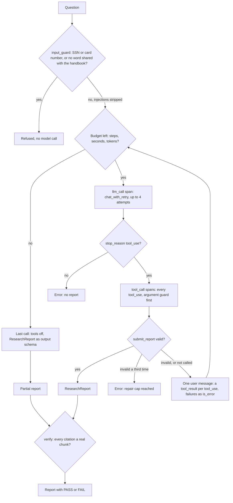

# Lesson 10: Capstone

Every prior lesson taught one concern in isolation. Real agents combine them. The capstone is a small but complete **research agent** that uses every prior topic in one program:

| Topic | Where it shows up |
|---|---|
| Mental model (00) | The loop is the backbone |
| Tool calling (01) | `search_docs`, `remember`, `recall`, `ask_user`, `submit_report` |
| Structured outputs (02) | `ResearchReport` schema with citations and confidence |
| RAG (03) | `search_docs` against the Acme corpus |
| Memory (04) | `remember` / `recall` for user specific facts |
| Retries (05) | Transport retry + schema error repair around `submit_report` (cap 2 retries) |
| HITL (06) | `ask_user` when the question is ambiguous |
| Eval & tracing (07) | JSONL spans + 6 fixture cases |
| Guardrails (08) | Input guard refuses PII and off topic questions; argument guards on `search_docs`, `remember`, `recall` |
| MCP (09) | (Optional) tools served from an MCP subprocess |

The lesson is intentionally **harder to read than any single previous file**. That's the point: production agents are integrations, not single concerns.

## The loop at a glance



Everything from the input guard to the tool calls runs inside one `agent_run` span, so the JSONL trace holds every model call and tool call of the run. The budget is checked before every model call, and citation verification runs after the agent returns, in `capstone_agent.py` when run directly and in `run_evals.py` for the fixtures.

Every `tool_use` of a turn is answered in the very next user message, one `tool_result` each; the API rejects a request where one is missing. That includes a failed `submit_report`: its validation errors go back as an `is_error` tool result in the same message as the other results, not as a separate text message.

`run_agent` returns `(report, trace_path, outcome)`. The outcome says how the run ended: `report`, `partial: <limit>`, `refused: <reason>` or `error: <reason>`.

## The agent's job

Given a user question:

1. Check input guard. Refuse if off topic or contains PII.
2. If ambiguous, call `ask_user` to clarify (max once).
3. Search the corpus. May search multiple times with refined queries.
4. Optionally `remember` a user fact for next time.
5. Submit a `ResearchReport` with answer, citations, and confidence.
6. The harness verifies citations actually exist and writes a JSONL trace.

## Failure paths it has to handle

- Question is off topic → input guard returns refusal; no LLM call made. The check is a rule, not a model call: the question must share at least one content word (not a function word such as "the" or "what") with the handbook's own vocabulary. It is deliberately loose: "pets in the office" passes and gets a low confidence report, "the capital of Portugal" is refused.
- Search returns nothing relevant → agent should say so, not invent.
- `submit_report` validation fails → the errors go back as an `is_error` tool result and the model tries again (cap 2 retries; a third invalid report ends the run without one).
- Transport error → exponential backoff (cap 4 attempts).
- Budget exhausted → graceful stop with partial answer: one last call with tools switched off (`tool_choice: none`) and `ResearchReport` as the output schema, so the model writes its best report from what it found. The outcome says `partial`, and its citations are verified like any other. This call comes on top of the budget: the price of not returning empty handed.
- Citation list references nonexistent chunks → mark report as untrustworthy.
- Tool arguments out of bounds → the argument guard answers with an `is_error` result and the tool never runs. `search_docs` takes a query of at most 300 characters (`k` is capped at 6 by the schema); `remember` refuses a key that is not snake_case, a value over 200 characters, and any SSN, card number or email address, because memory outlives the run.

## Files

- `capstone_agent.py`: the agent. ~550 lines. Reads like a synthesis of every prior file.
- `fixtures.jsonl`: 6 eval cases (similar to Lesson 07); the last one expects the input guard to refuse.
- `run_evals.py`: runs the agent against fixtures, writes traces, prints a summary.

## How to run

```powershell
# One question, interactive
uv run python lessons/10_capstone/capstone_agent.py "How many vacation days do I get?"

# Eval suite
uv run python lessons/10_capstone/run_evals.py
```

Traces land in `traces/capstone_<ts>.jsonl`. View with:

```powershell
uv run python lessons/07_eval_tracing/02_trace_viewer.py traces/<file>.jsonl
```

## What to do next

This is the end of the course as a linear path. Suggested extensions to deepen each topic:

- **Tools**: write a tool that calls a real API (e.g., GitHub). Handle auth and rate limits.
- **RAG**: swap the TF-IDF retriever for OpenAI embeddings or sentence-transformers. Measure the quality delta on the fixtures.
- **Memory**: replace the JSON file with SQLite. Add a `forget(key)` tool. Measure retention quality with a multi session fixture.
- **HITL**: wire the durable pause harness to a small FastAPI app so a human can approve via HTTP.
- **Tracing**: ship the JSONL spans to a real backend (Phoenix, Langfuse).
- **Guardrails**: add a fine grained PII classifier. Measure false positive rate on the fixtures.
- **MCP**: write a second MCP server in a different language (Rust, TypeScript) and connect both at once.

You now know enough to read framework code (LangChain, LangGraph, AutoGen, CrewAI) as variations on the patterns in this course. Read one; identify which Lesson concept maps to which abstraction. That exercise makes frameworks tools, not magic.

The same exercise works for Anthropic's own harnesses: the SDK's Tool Runner, the Claude Agent SDK and Claude Managed Agents each package some of what you built by hand here. Lesson 10b maps every lesson onto them.

Next: [Lesson 10b: Harnesses](../10b_harnesses/README.md).
