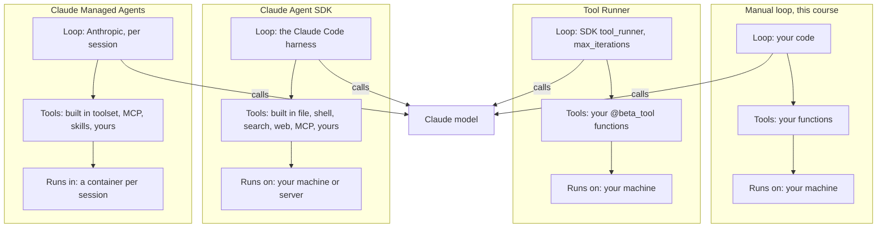

# Lesson 10b: Harnesses

You built every part of an agent by hand: the loop, the dispatcher, retries, approval gates, traces, guards, the MCP client. That was the point. Now that you know what each part does, you can recognize it inside the products that ship it for you, and judge what they do and do not cover.

A **harness** is everything around the model call: the loop, tool execution, context management, permissions, state. Two questions separate the options:

1. **Who writes the harness?** You, the SDK, or Anthropic.
2. **Who runs the deployment?** Your machine and servers, or Anthropic's.

| Option | You write | Harness | Deployment | Tools |
|---|---|---|---|---|
| Manual loop (this course) | The loop and every tool | You | You | Only yours |
| Tool Runner (`anthropic` package, beta) | The tool functions | SDK | You | Only yours |
| Claude Agent SDK (separate package) | A prompt and options | SDK (the Claude Code harness) | You | Built in file, shell, search and web tools, plus MCP and yours |
| Claude Managed Agents (beta) | An agent config, then sessions | Anthropic | Anthropic (a sandbox per session) | Built in toolset in the sandbox, plus MCP, skills and yours |

The Tool Runner and the Agent SDK sound alike and are often confused. The Tool Runner is a helper inside the ordinary API SDK that loops over tools you define; it has no built in tools and no filesystem access. The Agent SDK is Claude Code packaged as a library, with its own tools and harness. Neither hosts anything: that is what Managed Agents adds.

## The loop at a glance



The model call is the same in all four; read each column top to bottom to see who owns the loop, where the tools come from and where they execute. Moving right, more of the harness moves from your code to the SDK and then to Anthropic.

## The Tool Runner

`client.beta.messages.tool_runner(...)` takes the same arguments as `messages.create`, plus `max_iterations`, and a list of tools made with the `@beta_tool` decorator. The decorator reads the function's type hints and docstring and produces the schema; the runner calls the model, runs your function for each `tool_use`, appends the results, and repeats until the model stops calling tools.

```python
@beta_tool
def search_docs(query: str, k: int = 3) -> str:
    """Search the Acme company handbook.

    Args:
        query: A natural language query.
        k: How many passages to return.
    """
    ...

runner = client.beta.messages.tool_runner(
    model=DEFAULT_MODEL, max_tokens=8000, max_iterations=6,
    tools=[search_docs], messages=[{"role": "user", "content": question}],
)
for message in runner:      # each assistant message, before its tools run
    ...
final = runner.until_done() # or just run to the end
```

It is not a black box. Iterating the runner hands you each assistant message before its tools execute, so the course's patterns still fit:

- **Approval (Lesson 06):** gate inside the tool function and return "user declined", or inspect the pending call in the loop and change the next request with `set_messages_params()` or `append_messages()`.
- **Tool errors (Lesson 05):** an exception raised in your function goes back to the model as an error result; inspect results with `generate_tool_call_response()` before they are sent.
- **Budget (Lesson 00):** `max_iterations`.
- **Guards (Lesson 08):** put the argument guard at the top of the tool function, exactly as in `03_tool_arg_guard.py`.

Reach for a manual loop only when you need a control flow the runner cannot express, or want no beta dependency.

## The Claude Agent SDK

The Claude Agent SDK (`claude-agent-sdk` for Python, `@anthropic-ai/claude-agent-sdk` for TypeScript) is the harness behind Claude Code, as a library. You give it a prompt and options; it drives the whole loop on your machine or server. It ships:

- **Built in tools** for reading, writing and editing files, running shell commands, searching (glob and grep) and fetching from the web. These are Lesson 08b's tools, with their sandboxing and permission handling already written.
- **Permissions:** which tools may run without asking, which need approval, which are denied. Lesson 06's policy table as configuration.
- **Hooks:** your code runs before or after a tool call, so you can log, block or rewrite it. Lesson 07's tracing and Lesson 08's tool argument guards attach here.
- **Subagents:** the orchestrator and worker pattern of Lesson 09b, with each subagent in its own context.
- **MCP servers** (Lesson 09) as tool sources, **sessions** you can resume, and context management for long runs (Lesson 00b).

Use it when you want a batteries included coding or file agent and are happy to host it yourself. It is a separate product from the API SDK used in this course; its documentation is at [code.claude.com/docs/en/agent-sdk](https://code.claude.com/docs/en/agent-sdk). Read its permission and hooks pages first: they are where your judgment still matters.

## Claude Managed Agents

With Managed Agents (beta) Anthropic runs the loop **and** hosts the place where tools execute. The API has three main objects:

- **Agent:** a stored, versioned config: model, system prompt, tools, MCP servers, skills. Create it once and reuse its id; updating it makes a new version, and running sessions keep theirs.
- **Environment:** the container template the tools run in: Anthropic's cloud or your own infrastructure (self hosted), with networking that can be limited to listed hosts.
- **Session:** one run of an agent in a fresh container. You send user messages as events and read the agent's actions from an event stream; the session keeps its own state between messages.

The built in toolset (bash, file operations, web search and fetch) runs in that container, and each tool gets a permission policy: always allow, always ask (the session pauses until you send a confirmation), or `auto`, where the server decides per call and pauses when unsure. Text in tool results and fetched pages counts as data, not as your intent, when the server decides: Lesson 08's indirect injection defense, built in. On top of that come memory stores, multi agent sessions, outcomes graded against a rubric, credentials held in vaults, scheduled runs and session budgets.

Use it when you want no loop code, no sandbox to operate, and agents that run for a long time, on a schedule, or for many users. The trade offs: it is a beta, files must be uploaded or a repository mounted into the session, and you control less of the loop. Start at [platform.claude.com/docs/en/managed-agents/overview](https://platform.claude.com/docs/en/managed-agents/overview).

## Where each lesson lives

| Course topic | Manual loop (this course) | Tool Runner | Claude Agent SDK | Managed Agents |
|---|---|---|---|---|
| Loop (00) | Your `for step in range(...)` | The runner; `max_iterations` | Built in | Server side, per session |
| Long context (00b) | You trim and summarize | Server side compaction, `compact_before_next_turn()` | Built in context management | Server side |
| Tools (01) | Registry, schema, dispatcher | `@beta_tool` from the function signature | Built in tools plus yours | Built in toolset plus custom tools |
| Structured output (02) | `output_schema` in `chat()` | Same request parameters | Options of the SDK | Agent config |
| RAG (03) | `search_docs` tool | `search_docs` function (`01_tool_runner.py`) | Search tools over files, or yours | Files in the sandbox, MCP, yours |
| Memory (04) | JSON or KV file | Yours | Sessions, files on disk | Session state, memory stores |
| Retries (05) | Hand rolled backoff | SDK client retries; tool errors returned to the model | Built in | Server side |
| Human in the loop (06) | Policy table, `input()` | Gate in the tool function or in the loop body | Permission settings and hooks | Permission policies, tool confirmations |
| Evals and tracing (07) | JSONL spans | SDK OpenTelemetry tracing | Hooks, its own monitoring | Console session viewer, event history |
| Guardrails (08) | Input, output and argument guards | Guards inside tool functions | Hooks before a tool runs | Permission policies, limited networking |
| Coding agents (08b) | Your sandbox and allowlist | Yours | Built in file and shell tools | Per session container |
| MCP (09) | Your MCP client | MCP conversion helpers in the SDK | MCP servers in options | MCP servers on the agent, credentials in vaults |
| Multi agent (09b) | Orchestrator calling workers | Yours | Subagents | Multi agent sessions |

Read a row as a checklist. Whatever is "yours" in a column is still your job in that product.

## Hands on

### `01_tool_runner.py`

The Lesson 03b RAG agent again, this time with the Tool Runner. One decorated function over the Lesson 03a TF IDF index replaces the registry, schema, dispatcher and loop. The script first prints the schema `@beta_tool` generated from the signature and docstring, then iterates the runner so you can watch each step's tool calls and token counts. Put it next to `lessons/03b_rag_in_loop/01_rag_tool.py` and list what disappeared.

## Key takeaways

- A harness is the loop plus tool execution, context, permissions and state. Every product in this lesson is one.
- Tool Runner: the SDK runs the loop over your tools. Agent SDK: the Claude Code harness with built in tools, on your infrastructure. Managed Agents: Anthropic runs the loop and the sandbox.
- Each lesson's concern still exists in each option; only who owns it changes.
- Pick the simplest option that covers your needs, and know which rows of the table are still yours.

## Common misconceptions

- **"The Tool Runner is the Agent SDK."** Different packages. The runner has no built in tools.
- **"A framework makes the agent safe."** It gives you permission settings and hooks. Choosing what to allow is still your decision.
- **"Hosted means I can skip evals."** The loop moved; measuring whether the agent does the job did not.
- **"I wasted time building it by hand."** You can now read any harness's settings and know what each one does, and you can tell when one does not fit.

## Where to go next

- Rebuild one earlier lesson on the option you would actually use, and compare traces with your own version.
- Port the capstone (Lesson 10) to the Tool Runner, keeping its guards, retries and evals.
- Try the Agent SDK on a small repository with read only permissions first, then allow edits behind a hook that logs every change.
- Run one Managed Agents session with the built in toolset, tools set to always ask, and read the event stream: you will recognize every event from this course.
- Keep the reference close: the tool use and agent design pages at [platform.claude.com/docs](https://platform.claude.com/docs), and the Agent SDK docs at [code.claude.com/docs/en/agent-sdk](https://code.claude.com/docs/en/agent-sdk).
